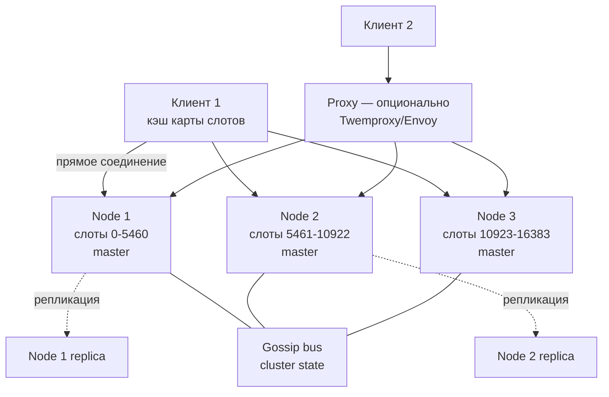

# Проектирование распределённого кэша (аналог Redis Cluster / Memcached)

**Задача:** спроектировать in-memory хранилище ключ-значение, распределённое по множеству нод, с репликацией и вытеснением.

---

## 1. Требования

### Функциональные
- `GET key`, `SET key value [TTL]`, `DELETE key`
- Атомарные операции: `INCR`, `SETNX`, `EXPIRE`
- TTL и автоматическое вытеснение
- Репликация (устойчивость к отказу ноды)
- Ограничения по памяти на ноду

**За рамками:** persistence на диск (AOF/RDB), транзакции, pub/sub, Lua-скрипты, стримы.

### Нефункциональные
- **Масштаб:** 10 ТБ данных в памяти, 100 нод, **1 млн ops/сек**
- **Latency:** < 1 мс (P99) внутри региона
- **Доступность:** 99.95% — кэш, при отказе система деградирует, но не падает
- **Консистентность:** eventual между репликами (приемлемо: кэш временный)
- **Elasticity:** добавление/удаление ноды без простоя и без полного пересчёта ключей

---

## 2. Ключевое решение: как распределить ключи

### 2.1 Хеш по модулю — не годится
```
node = hash(key) % node_count
```
- ✓ Просто
- ✗ **Добавили одну ноду из 100 → 99% ключей меняют владельца** → лавина cache miss → БД умирает

### 2.2 Consistent Hashing
Кольцо из 2³² позиций. Каждая нода занимает несколько точек (виртуальные узлы). Ключ идёт к первой ноде по часовой стрелке.

- ✓ Добавление ноды переносит только `1/N` ключей (сосед по кольцу)
- ✓ Виртуальные узлы (150–200 на ноду) выравнивают распределение
- ✗ При отказе ноды её нагрузка целиком идёт одному соседу (без реплик)
- ✗ Плохо для «горячих» ключей — один ключ всегда на одной ноде

### 2.3 Hash Slots (Redis Cluster) — выбор
16384 слота. `slot = CRC16(key) % 16384`. Слоты распределяются по нодам.

- ✓ Тот же эффект, что у consistent hashing, но **проще администрировать**: перенос слота — атомарная операция
- ✓ Клиент знает карту слотов → может идти напрямую к нужной ноде (без прокси)
- ✓ Клиент может кэшировать карту слотов → нет лишнего хопа
- ✗ Ключи с одинаковым префиксом могут лежать на разных нодах → мульти-ключевые операции требуют «hash tags» (`{user:1}:name`, `{user:1}:age` — один слот)

**Почему 16384, а не больше:** карта слотов передаётся в каждом handshake и в gossip-сообщениях; 16k × 2 байта = 32 КБ — компромисс между гранулярностью и накладными расходами. 65536 дало бы больше гибкости, но удвоило бы трафик служебных сообщений.

---

## 3. Архитектура



### Gossip-протокол
Ноды обмениваются состоянием кластера (кто жив, какие слоты у кого) через gossip. Каждая нода периодически (раз в секунду) отправляет PING нескольким случайным нодам. Если нода не отвечает `node-timeout` (например, 5 сек) — помечается `PFail`, при подтверждении кворумом мастеров — `Fail`, и её слоты перераспределяются на реплику.

**Почему gossip, а не ZooKeeper/etcd:** кэш должен работать без внешней зависимости. Gossip устойчив к разделению сети (нет единой точки отказа) и не требует отдельного кластера. Цена — eventual-консистентность карты слотов (несколько секунд расхождения).

---

## 4. Детали компонентов

### 4.1 Хранение в памяти — hash table + allocator

Классический подход — chained hash table с инкрементальным rehash:
- Две таблицы: `ht[0]` (текущая) и `ht[1]` (новая, при расширении)
- При rehash на каждом запросе переносятся несколько бакетов → нет стоп-зе-ворлд паузы
- Загрузочный фактор ~1.0 при расширении, ~0.1 при сжатии

**Память — главный ресурс:**
- Ключ + значение + overhead (заголовки объекта, allocator fragmentation) ≈ 1.5–2× от «полезных» данных
- 100 нод × 128 ГБ RAM = 12.8 ТБ «сырой» памяти → ~7 ТБ полезных данных
- Отсюда требование: **явный лимит `maxmemory`** на ноду, иначе OOM-killer убьёт процесс

**Фрагментация:** после удаления больших значений память не возвращается ОС. Нужен периодический `memory purge` (jemalloc) или перезапуск ноды при высоком `mem_fragmentation_ratio`.

### 4.2 Вытеснение (eviction)

Когда память кончается, надо кого-то удалить. Политики:

| Политика | Как | Когда |
|---|---|---|
| `noeviction` | Ошибка на запись | Кэш как БД (не наш случай) |
| **`allkeys-lru`** | Удалить наименее недавно использованный | Общий кэш — **выбор по умолчанию** |
| `allkeys-lfu` | Удалить наименее часто использованный | Есть стабильно горячий набор |
| `volatile-lru` | LRU только среди ключей с TTL | TTL = «временное» |
| `allkeys-random` | Случайный | Простейший, но плохое качество |

**Точный LRU дорог** — нужен двусвязный список на каждый ключ (2 указателя × 8 байт × 1 млрд ключей = 16 ГБ оверхеда).

**Practical LRU (Redis):** приближённый — на каждом ключе хранится 24-битный timestamp последнего доступа (LRU clock), при вытеснении берётся случайная выборка из 5 ключей и удаляется самый старый. Точность ~90% от идеального LRU при 5 байтах оверхеда вместо 16.

**LFU (Redis 4+):** счётчик частоты с логарифмическим затуханием — 8-битный счётчик + время последнего decrement. Позволяет горячим ключам выживать.

### 4.3 TTL

- **Ленивая проверка:** при `GET` проверяем `expires_at`, если просрочен — удаляем и возвращаем miss
- **Активная проверка (active expire cycle):** раз в 100 мс берём 20 случайных ключей с TTL, удаляем просроченные; если >25% из них просрочены — повторяем цикл сразу
- Почему не таймер на каждый ключ: 1 млрд таймеров — это отдельная структура, которая съедает память и CPU

**TTL и репликация:** реплики не удаляют по TTL сами — мастер отправляет `DEL` как обычную команду. Иначе реплики и мастер разойдутся (время у них может отличаться).

### 4.4 Репликация

**Асинхронная (как в Redis):**
1. Реплика подключается, мастер делает `BGSAVE` → RDB-снимок → отправляет реплике
2. Дальше мастер стримит все команды записи в реплику
3. При разрыве — частичная ресинхронизация из backlog-буфера (кольцевой буфер последних N команд); если реплика отстала больше чем на backlog → полная ресинхронизация через RDB

- ✓ Быстрая запись (мастер не ждёт реплик)
- ✗ **Потеря данных при failover** — то, что мастер не успел отправить, потеряно
- Для кэша это **приемлемо**: потерянные записи придут при следующем cache miss

**Failover:** при отказе мастера реплика повышается. Два варианта:
- **Автоматически** через sentinel/cluster consensus (кворум мастеров голосует)
- **Вручную** — проще, но простой длиннее

**Split-brain:** сеть разделилась, старый мастер живёт в меньшинстве, реплика в большинстве повысилась → две «правды». Решение — **fencing token** (номер эпохи/term): клиент, увидевший более высокий term, отвергает ответы от старого мастера. Та же идея, что в Raft.

### 4.5 Клиентская маршрутизация vs прокси

| Подход | Как | Плюсы | Минусы |
|---|---|---|---|
| **Smart client** | Клиент знает карту слотов, идёт напрямую | Минимум хопов, минимум latency | Клиентская библиотека должна понимать кластер |
| **Proxy** (Twemproxy, Envoy) | Клиент → прокси → ноды | Клиент простой, любой язык | +0.3–0.5 мс, прокси = доп. точка отказа, нужен скейлинг прокси |
| **Sidecar** | Прокси рядом с приложением | Локальный хоп, простота клиента | Больше контейнеров |

**Для latency-критичных сценариев — smart client.** Прокси оправдан, когда клиентов много и они на разных языках.

---

## 5. Узкие места

### 5.1 Горячий ключ
Один ключ (например, счётчик просмотров топ-видео) — 100k ops/сек на одну ноду.
- Один слот = одна нода → потолок ~100–150k ops/сек на ноду
- **Решение 1:** локальный кэш в приложении (in-process, TTL 1 сек) — снижает до 1/1000 нагрузки
- **Решение 2:** шардирование ключа — `counter:video:42:{0..9}`, `INCR` в случайный, чтение суммирует 10 значений. Точность/атомарность теряется.
- **Решение 3:** read replicas — читаем с реплик (для read-hot ключей работает без потерь)

### 5.2 Cache stampede при отказе ноды
Нода умерла → её 1/100 ключей стали промахами одновременно → БД получает всплеск ×100.
- **Реплика принимает слоты** — если репликация синхронная/почти синхронная, кэш почти не теряется
- **Задержка перед повышением:** не спешить объявлять ноду мёртвой (30 сек), иначе ложные failover при кратком лаге
- **Circuit breaker на БД:** ограничить QPS к источнику, отдавать stale/ошибку вместо обрушения

### 5.3 Решардинг при добавлении ноды
Добавили 101-ю ноду → нужно перенести ~160 слотов.
- Слоты переносятся **по одному**, атомарно: `MIGRATE` (или `CLUSTER SETSLOT` + `IMPORTING`/`MIGRATING`)
- Во время переноса слот находится в промежуточном состоянии: клиент, попавший на «старую» ноду за перенесённым ключом, получает `ASK`-редирект на новую
- Перенос 160 слотов × 128 ГБ/16384 × 160 ≈ 200 ГБ → минуты-часы, делается в фоне ночью

### 5.4 Мульти-ключевые операции
`MGET k1 k2 k3` — если ключи на разных нодах, клиент делает 3 запроса и собирает ответ.
- **Hash tags:** `{user:1}:name` и `{user:1}:age` — хешируются только символы внутри `{}` → один слот
- Транзакции и Lua-скрипты тоже требуют один слот — отсюда важность hash tags в дизайне ключей

### 5.5 Большие значения
Ключ на 100 МБ (JSON) → блокирует ноду на время сериализации, ломает latency P99.
- Лимит на размер значения (например 1 МБ)
- Большие объекты — в объектное хранилище, в кэше только ссылка

---

## 6. Что показать на интервью

Порядок изложения, который выглядит сильно:

1. **Сначала спросить:** что кэшируем, какой размер значения, нужна ли durability, допустима ли потеря при failover. Без этого нельзя выбрать политику вытеснения и репликацию.
2. **Consistent hashing / hash slots** — с объяснением, почему `% N` ломается при решардинге (это классический вопрос).
3. **Eviction** — обязательно упомянуть, что точный LRU дорог, и как делается приближённый.
4. **Репликация** — асинхронная, потеря при failover приемлема для кэша; split-brain решается term/epoch.
5. **Проблема горячего ключа** — интервьюеры почти всегда спрашивают. Ответ: локальный кэш + шардирование ключа.
6. **Решардинг** — как переносятся слоты без простоя (ASK-редиректы).

---

## 7. Итог

| Аспект | Решение | Почему |
|---|---|---|
| Распределение | 16384 hash slots + gossip | Перенос без лавины miss, без внешнего координатора |
| Eviction | Приближённый LRU (выборка из 5), `allkeys-lru` | Точный LRU = 16 ГБ оверхеда |
| TTL | Lazy + active cycle (20 ключей / 100 мс) | Таймер на ключ съедает память |
| Репликация | Асинхронная, RDB + backlog | Кэш терпит потерю; запись быстрая |
| Failover | Кворум + fencing token (term) | Защита от split-brain |
| Маршрутизация | Smart client с кэшем карты | Минимум хопов |
| Большие значения | Лимит 1 МБ, ссылки на S3 | Блокировка ноды убивает P99 |

**Главная мысль для интервью:** распределённый кэш — это в первую очередь **управление памятью** (eviction, фрагментация, лимиты) и **управление распределением** (слоты, решардинг, горячие ключи). Persistence и транзакции — вторичны, их часто вообще не требуется.
