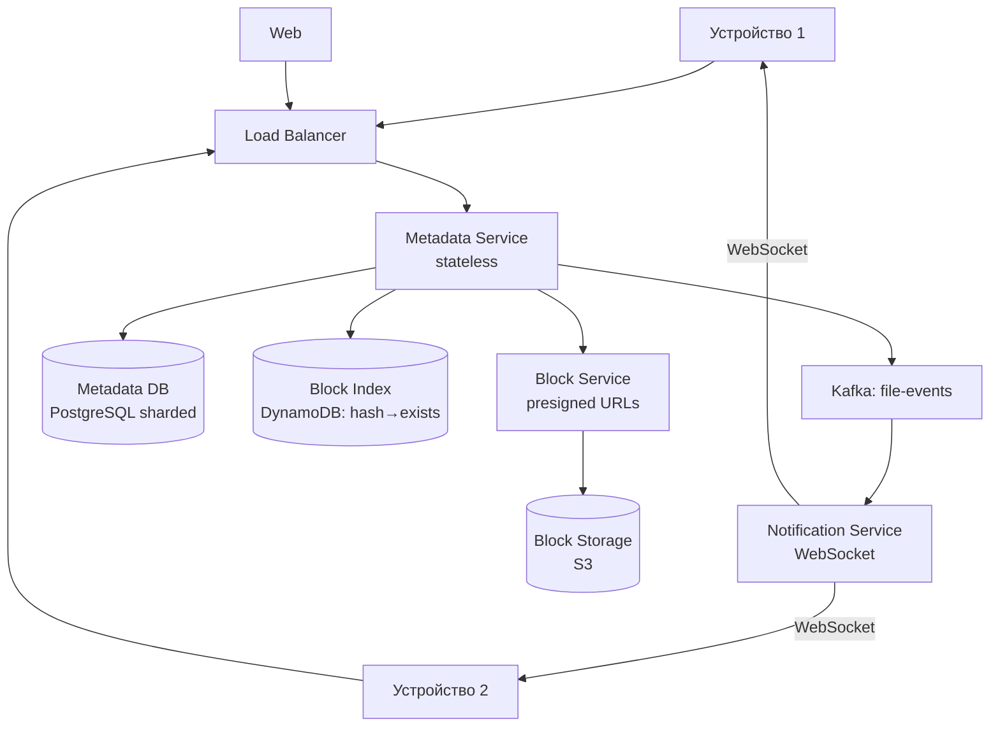

# Проектирование файлового хостинга (аналог Dropbox)

**Задача:** спроектировать сервис синхронизации файлов между устройствами пользователя.

---

## 1. Требования

### Функциональные
- Загрузка и скачивание файлов и папок
- Автоматическая синхронизация между устройствами пользователя
- История версий файла (последние 30 дней)
- Шаринг файлов и папок другим пользователям (read / write)
- Работа офлайн с досинхронизацией при подключении

**За рамками:** совместное редактирование документов в реальном времени, поиск по содержимому.

### Нефункциональные
- **Масштаб:** 500 млн пользователей, 1.5 млрд устройств, 500 млрд файлов
- **Нагрузка:** ~1 млн изменений файлов/сек в пике
- **Объём:** 100+ ЭБ хранилища (у Dropbox реально ~эти порядки)
- **Latency:** загрузка начинается < 1 сек, синхронизация изменения < 5 сек
- **Доступность:** 99.99% — люди держат там работу
- **Durability:** 11 девяток — потеря файла неприемлема (S3 даёт это)
- **Консистентность:** **строгая в рамках одного аккаунта** — если файл изменён на телефоне, десктоп не должен видеть смесь версий

---

## 2. Ключевое решение: блочная синхронизация

**Наивный подход:** изменил файл → загрузил целиком. При 100 МБ презентации и правке одной строки — 100 МБ трафика. Это убивает и сеть, и деньги.

**Решение: контентная адресация блоками (content-defined chunking)**

1. Файл режется на блоки **по содержимому**, а не по фиксированному размеру. Используется rolling hash (Rabin fingerprint / buzhash): сканируем байты окном, режем там, где хеш попадает под условие.
2. Каждый блок → SHA-256 → это его **ключ** в хранилище.
3. Клиент отправляет серверу список хешей (манифест): `[h1, h2, h3, ...]`
4. Сервер отвечает: «эти хеши у меня уже есть, пришли только h4 и h7»
5. Клиент загружает **только новые блоки**
6. Сервер создаёт новую «версию файла» — это просто список ссылок на блоки

**Почему content-defined, а не фиксированные 4 МБ:** вставка байта в начало файла сдвигает все блоки → все хеши меняются → загружается весь файл. Content-defined границы «прилипают» к содержимому: вставка меняет 1–2 блока, остальное совпадает.

**Эффект:**
- Правка одной строки в 100 МБ файле → загрузка ~1 МБ вместо 100 МБ
- Одинаковые файлы у миллиона пользователей хранятся **один раз** (дедупликация на уровне блоков)
- Переименование файла = копирование манифеста, 0 байт трафика

---

## 3. Архитектура



### Поток «пользователь изменил файл»

1. Клиент замечает изменение (файловый watcher: FSEvents/inotify)
2. Клиент режет файл на блоки, считает SHA-256 каждого
3. Клиент → Metadata Service: `POST /commit {path, blocks:[h1,h2,...]}`
4. Metadata Service:
   - Проверяет в Block Index, каких блоков нет (batch lookup в DynamoDB)
   - Возвращает список отсутствующих хешей + presigned URLs на загрузку
5. Клиент грузит только отсутствующие блоки напрямую в S3
6. Клиент → Metadata Service: `POST /commit/confirm {file_id, blocks}`
7. Metadata Service:
   - Пишет новую версию: `versions(file_id, version, blocks[], size, mtime)`
   - Обновляет «текущую версию» файла
   - Публикует `FileChanged{user_id, file_id}` в Kafka
8. Notification Service получает событие → пушит через WebSocket **всем другим устройствам** этого пользователя
9. Другие устройства: `GET /files/{id}/manifest` → видят новые хеши → скачивают только недостающие блоки → собирают файл локально

---

## 4. Детали компонентов

### 4.1 Metadata DB — PostgreSQL, шардированный по `user_id`

Почему не NoSQL: нужно **транзакционно** обновлять «файл + новая версия + права доступа» атомарно, иначе получим файл без версии или версию без прав. Плюс нужны запросы вроде «все файлы в папке», «кто имеет доступ».

```sql
files(id, user_id, path, current_version, size, mtime, is_deleted)
versions(file_id, version, blocks JSONB, size, created_at)
shares(file_id, shared_with_user_id, permission)
```

**Шардирование по `user_id`** — все данные одного аккаунта на одном шарде. Синхронизация всегда в рамках аккаунта, кросс-шардовые транзакции не нужны. Одна проблема: шаринг между пользователями → нужна отдельная таблица `shares` с репликацией или отдельная БД для прав.

**Индекс, который решает всё:** `(user_id, path)` уникальный — быстрый поиск файла по пути, и защита от конфликтов.

### 4.2 Block Index — DynamoDB

```
PK: block_hash,  value: {ref_count, size}
```
- Запрос «какие из 500 хешей у меня есть» — BatchGetItem, 100 ключей за раз
- `ref_count` — сколько версий файлов ссылаются на блок (для GC)
- Единственный паттерн доступа → key-value идеален, и масштаб тут большой (сотни миллиардов блоков)

### 4.3 Block Storage — S3

- Ключ объекта = SHA-256 блока. Контентная адресация даёт бесплатную дедупликацию.
- **Проблема:** S3 не позволяет «создать, только если нет» атомарно и не даёт ref_count. Гонка: два клиента одновременно грузят одинаковый блок — оба загрузили, но ref_count = 1.
- **Решение:** идемпотентная запись (перезапись того же объекта теми же байтами безвредна) + ref_count считается в Block Index через DynamoDB atomic counter (`ADD ref_count 1`), а не по факту наличия в S3.

### 4.4 Notification Service — WebSocket

- Каждое устройство держит WS-соединение
- Реестр устройств: `user:{id} → [device_ids]`
- При `FileChanged` — пуш на все активные устройства аккаунта
- Push содержит **только метаданные** (file_id, новый version), тело файла тянется отдельно
- При офлайне — при следующем подключении устройство делает `GET /sync?cursor=...` и догоняет

### 4.5 Конфликты

**Последняя запись побеждает?** Нет — это потеря данных.

**Решение Dropbox:** файловая система, а не Google Docs. Конфликт = два разных файла.
- Устройство A и B одновременно изменили файл из версии v5
- Первое дошедшее изменение становится v6, второе — получает **конфликтную копию**: `Отчёт (конфликтная копия от 2026-11-16).docx`
- Пользователь сам решает, что делать

**Как определить конфликт:** оптимистическая блокировка. `POST /commit` содержит `base_version`. Если `base_version != current_version` → конфликт, сервер создаёт копию.

### 4.6 Синхронизация при старте (большая папка)

Пользователь поставил Dropbox на новый ноутбук, у него 500 ГБ файлов.
- Нельзя скачивать всё — ноутбук 256 ГБ
- **Selective sync:** пользователь выбирает папки
- **Smart sync:** файлы видны как «только в облаке» (плейсхолдеры), скачиваются при открытии. На macOS — File Provider API, на Windows — Cloud Files API
- Метаданные (пути, размеры) синхронизируются всегда — это мегабайты, не гигабайты

---

## 5. Узкие места

### 5.1 Миллион мелких файлов
Проект с 200k файлов по 1 КБ — блоки по 1 КБ, манифест на 200k записей.
- **Пакетная обработка:** один `commit` на папку, а не на файл
- **Манифест сжимается** (zstd), 200k хешей × 32 байта = 6.4 МБ → ~2 МБ
- Мелкие блоки (< 256 КБ) **не дедуплицируются** — накладные расходы больше выгоды

### 5.2 GC старых блоков
Блок не нужен, если его `ref_count = 0` (все версии, ссылающиеся на него, удалены).
- Version history 30 дней → старые версии удаляются ежедневным джобом
- При удалении версии → декремент `ref_count` всех её блоков
- `ref_count = 0` → удалить из S3
- **Опасность:** гонка «удалили блок» / «другой клиент его загружает». Защита — не удалять блоки младше 24 часов.

### 5.3 Шаринг и права
Папка расшарена на 100 человек, один изменил файл → 99 должны получить обновление.
- События рассылаются всем, у кого есть доступ (таблица `shares`)
- При отзыве доступа — нужно инвалидировать локальные копии (иначе у бывшего коллеги остаётся файл)
- Reality: файл уже скачан — отозвать нельзя, только запретить дальнейшие синхронизации

### 5.4 Стоимость хранения
100 ЭБ даже в S3 — это ~$2 млрд/год.
- Дедупликация блоков экономит 30–50% (одинаковые фото, документы)
- Lifecycle: старые версии → Glacier
- Реальный Dropbox: cold storage для файлов, не открывавшихся год

---

## 6. Итог

| Компонент | Решение | Почему |
|---|---|---|
| Единица передачи | Content-defined блок ~4 МБ, SHA-256 | Правка 1 строки = 1 блок, а не весь файл |
| Метаданные | PostgreSQL по шардам `user_id` | Транзакции версий, запросы по путям |
| Индекс блоков | DynamoDB `hash → ref_count` | Один паттерн доступа, сотни миллиардов ключей |
| Блоки | S3, ключ = хеш | Дедупликация бесплатно, durability 11 девяток |
| Уведомления | WebSocket + cursor-sync | Мгновенно онлайн, догон офлайн |
| Конфликты | Конфликтная копия файла | Не терять данные, решает пользователь |

**Главная мысль для интервью:** Dropbox — это не про хранение файлов, а про **эффективную передачу изменений**. Блочная дедупликация + content-defined chunking — то, что делает продукт экономически возможным: без них трафик и хранилище вырастают на порядок.
