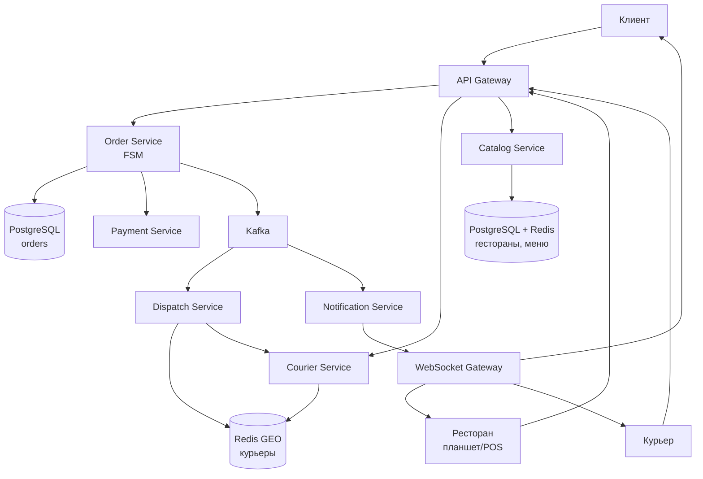

# Проектирование сервиса доставки еды (аналог DoorDash / Delivery Club)

**Задача:** спроектировать систему, где пользователь заказывает еду из ресторана, курьер её забирает и привозит.

---

## 1. Требования

### Функциональные
- Каталог ресторанов с меню, ценами, доступностью
- Корзина, оформление заказа, оплата
- Ресторан принимает/отклоняет заказ, отмечает готовность
- Система назначает курьера, ведёт его к ресторану, затем к клиенту
- Отслеживание статуса заказа в реальном времени
- Отмена и возврат средств

**За рамками:** программы лояльности, подписки, рейтинги курьеров, чаевые.

### Нефункциональные
- **Масштаб:** 500 000 ресторанов, 1 млн курьеров, 50 млн клиентов, 10 млн заказов/день
- **Нагрузка:** 10 млн / 86 400 ≈ **115 заказов/сек** (пик 1 000 в обед и вечером)
- **Пики:** обед 12:00–14:00 и ужин 18:00–21:00 — 60% заказов в 5 часах суток = **~350 заказов/сек** в среднем по пику
- **Latency:** каталог < 300 мс, обновление статуса < 2 сек
- **Доступность:** 99.95% — если приложение лежит в обед, теряются миллионы
- **Консистентность:** **строгая для заказа и денег**, eventual для каталога и позиции курьера

---

## 2. Ключевое отличие от такси

Такси: 2 актора (пассажир, водитель), одна точка назначения, поездка 15 минут.

Еда: **3 актора** (клиент, ресторан, курьер), **две точки** (ресторан → клиент), и главное — **время приготовления**. Курьер не должен приехать в ресторан раньше, чем еда готова (будет ждать и терять деньги), но и не позже (еда остынет).

Отсюда главная задача: **синхронизация трёх независимых таймлайнов**.

```
Клиент:    заказ → [ждёт 35 мин] → получает
Ресторан:  принял → готовит 20 мин → готов
Курьер:    принял → едет 8 мин → ждёт 3 мин → едет 12 мин → отдал
```

---

## 3. Архитектура



---

## 4. Жизненный цикл заказа (FSM)

```
created → paid → sent_to_restaurant → accepted_by_restaurant
→ preparing → ready_for_pickup
→ courier_assigned → courier_at_restaurant → picked_up
→ delivered
```

Ветки отмены: `cancelled_by_client`, `cancelled_by_restaurant`, `cancelled_by_system`, `refunded`.

**Почему FSM строго в БД, а не «просто статус»:**
- Деньги двигаются на каждом переходе (авторизация, списание, возврат)
- Недопустимые переходы = баг с деньгами: например, `refunded` после `delivered`
- Каждый переход — транзакция `UPDATE orders SET status=? WHERE id=? AND status=?`; 0 строк → недопустимый переход → ошибка

**Кто двигает статус:**
| Переход | Кто |
|---|---|
| `created → paid` | Payment Service (webhook от платёжного провайдера) |
| `paid → sent_to_restaurant` | Order Service (автоматически) |
| → `accepted_by_restaurant` | Ресторан (планшет) |
| → `preparing`, `ready_for_pickup` | Ресторан |
| → `courier_assigned` | Dispatch Service |
| → `courier_at_restaurant`, `picked_up` | Курьер (геозона + подтверждение) |
| → `delivered` | Курьер (подтверждение, либо автоподтверждение по геозоне) |

---

## 5. Dispatch — назначение курьера

### 5.1 Когда назначать

Два подхода:

**A. Сразу после принятия рестораном** (проще, чаще используется)
- Курьер едет к ресторану сейчас, ждёт еду если приехал раньше
- Риск: курьер простаивает 5–10 минут, эффективность падает
- Плюс: предсказуемое ETA для клиента

**B. С задержкой = (время готовки − время в пути курьера)**
- Курьер приезжает ровно к готовности
- Требует точного прогноза времени готовки и времени в пути
- Риск: ошибка прогноза → курьер опаздывает или ждёт

**Реальность:** большинство сервисов используют A с «умным» выбором курьера, который уже рядом с рестораном и освободится в нужное время (batching — курьер везёт два заказа по пути).

### 5.2 Алгоритм назначения

1. Dispatch получает событие `OrderReadyForCourier{restaurant_location, prep_eta}`
2. `GEOSEARCH` курьеров в радиусе 3 км, отсортированных по расстоянию
3. Фильтры: на смене, не занят (или занят, но может взять второй заказ по пути), рейтинг, тип транспорта (вело/авто — важен радиус)
4. Оценка кандидата: `score = f(расстояние до ресторана, ETA освобождения, рейтинг, история)`
5. Оффер лучшему, 15 сек на ответ → отказ → следующему
6. Атомарная проверка при принятии: `SET courier:{id}:assignment {order_id} NX EX 1800`

### 5.3 Batching — ключ к экономике

Курьер с одним заказом проезжает 5 км за 20 мин и зарабатывает X. С двумя заказами по пути — 6 км за 25 мин и зарабатывает 1.8X. Маржинальность доставки растёт в 1.5–2×.

**Как работает:**
- Курьеру, уже везущему заказ, предлагаются новые, если отклонение от маршрута < N минут
- Проверка: `detour = route(A→B→C) − route(A→B) < 8 мин`
- Заказ должен быть готов к моменту, когда курьер будет у ресторана

**Ограничение:** максимум 2–3 заказа на курьера, иначе еда остывает и клиент недоволен.

---

## 6. Детали компонентов

### 6.1 Catalog Service — каталог ресторанов

Читается в 100× чаще, чем пишется. Основная нагрузка — «покажи рестораны рядом».

- **PostgreSQL:** рестораны, меню, цены, часы работы. Объём небольшой (500k ресторанов).
- **Redis:** кэш меню (TTL 5 мин). Меню меняется редко, читается постоянно.
- **Геоиндекс ресторанов:** PostGIS или H3-ячейки — «рестораны в радиусе 2 км от точки».
- **Доступность ресторана** (открыт/закрыт, перегружен) — **не кэшируется** или TTL 30 сек: показать клиенту закрытый ресторан = потерянный заказ.
- **Цены:** хранятся как целые числа в минимальных единицах (копейках/центах) — никогда float.

**Персонализация выдачи:** рейтинг + расстояние + история заказов + промо. Считается на бэкенде, кэшируется per-user на 2 мин.

### 6.2 Order Service

```sql
orders(id, client_id, restaurant_id, courier_id, status, 
       subtotal_cents, delivery_fee_cents, tip_cents, total_cents,
       payment_intent_id, created_at, estimated_delivery_at)
order_items(order_id, menu_item_id, name_snapshot, price_cents, qty)
```

**Почему `name_snapshot` и `price_snapshot`:** если ресторан поменяет цену после заказа, чек должен остаться прежним. Денормализация здесь обязательна.

**Почему PostgreSQL:** деньги, ACID, отчёты, шардирование по `city_id` (заказы всегда локальны). 10 млн/день × ~1 КБ = 10 ГБ/день — нормально для шардированного PG.

### 6.3 Payment — идемпотентность и авторизация

**Двухфазная схема:**
1. При оформлении: **authorize** (заморозить сумму) — деньги ещё не списаны
2. При доставке: **capture** (списать)
3. При отмене до `capture`: **void** (разморозить)

**Почему не списывать сразу:** если ресторан отклонит заказ или курьер не найдётся — нужен возврат, а возвраты дороже и медленнее, чем отмена авторизации.

**Idempotency key:** каждый запрос к платёжному провайдеру содержит `order_id:attempt`. Ретрай с тем же ключом не спишет дважды. Клиент тоже присылает `client_request_id`, чтобы повторная отправка формы не создала два заказа.

**Проблема «сложной суммы»:** если клиент заказал на 1200 ₽, а после сборки выяснилось, что часть позиций кончилась → сумма меняется. Решение: partial capture (списать меньше авторизованной суммы) + уведомление клиента до сборки.

### 6.4 Отслеживание курьера

- Курьер шлёт локацию каждые 5 сек (в пути) / 30 сек (ждёт)
- Redis GEO → актуальная позиция для dispatch
- Kafka → трек в Cassandra для истории и разбора жалоб
- **Клиенту** — WebSocket, только позиция его курьера; карта остальных не нужна
- **Геозоны:** `courier_at_restaurant` определяется автоматически, когда позиция курьера внутри радиуса 50 м от ресторана 30 секунд подряд. Иначе курьеры забывают нажимать кнопку.

### 6.5 Уведомления и ETA

Клиент хочет знать «когда». ETA считается как:
```
ETA = prep_estimate + courier_travel_to_restaurant + courier_travel_to_client + buffer
```

Проблема: если курьер ещё не назначен, нельзя посчитать последние два слагаемых. Поэтому ETA показывается с **доверительным интервалом** («35–45 мин»), а не точной минутой. Когда курьер назначен — интервал сужается.

**Уведомления:** push + SMS для критичных переходов (заказ принят, курьер в пути, курьер у двери). SMS дорогие — только если push не дошёл (детектится по отсутствию `delivered` от APNs/FCM).

---

## 7. Узкие места

### 7.1 Обеденный пик
350 заказов/сек, курьеров столько же, сколько обычно.
- **Предзаказ:** клиент заказывает на 13:30 в 12:00 → заказ создаётся сразу, но dispatch запускается за 25 мин до нужного времени
- **Surge для курьеров:** повышенная оплата за смену в пик → больше курьеров онлайн
- **Очередь заказов:** если курьеров нет — заказ ждёт в `ready_for_pickup` с таймаутом; по истечении — отмена с возвратом (и ресторан получает компенсацию за испорченную еду)

### 7.2 Ресторан не подтверждает
Планшет разрядился, персонал забыл, POS упал.
- Автонапоминание через 2 мин, звонок через 5 мин
- Через 10 мин — автоотмена с возвратом и штрафом ресторану
- **Альтернатива:** авто-принятие для ресторанов с высоким рейтингом и низким процентом отмен (доверие на основе истории)

### 7.3 Расхождение адреса и реальности
Курьер приехал — клиент не отвечает, или адрес неверный.
- Таймер 10 мин у двери → попытки звонка → фото у двери → закрытие заказа как `delivered` (спор решается поддержкой)
- Курьер не должен простаивать: после 10 мин он освобождается для других заказов

### 7.4 Двойное назначение курьера
Два dispatch-инстанса одновременно выбрали одного курьера.
- `SET courier:{id}:assignment NX` в Redis — атомарно
- **Страховка в БД:** partial unique index `UNIQUE (courier_id) WHERE status IN ('courier_assigned','picked_up')`
- Redis может потерять ключ при failover → БД не даст назначить второго

### 7.5 Деньги при отменах
Отмена после `capture` → возврат. Кто платит за испорченную еду?
- Правила: клиент отменил до готовности — void, без списания; после готовности — списание стоимости еды ресторану
- Ресторан отменил — полный возврат клиенту + штраф ресторана
- Курьер не приехал — возврат клиенту + компенсация из фонда платформы

Это **не техническая, а продуктовая** логика, но она должна быть в коде как код (state machine + таблица правил), а не как «поддержка разберётся».

---

## 8. Итог

| Компонент | Решение | Почему |
|---|---|---|
| Заказы | PostgreSQL, FSM, шард по `city_id` | Деньги, ACID, заказы локальны |
| Каталог | PostgreSQL + Redis (TTL 5 мин) | Читается в 100× чаще, чем пишется |
| Курьеры на карте | Redis GEO | Много обновлений, нужна скорость |
| Dispatch | Greedy offer + batching | Экономика доставки держится на 2 заказах на курс |
| Оплата | authorize → capture, idempotency key | Отмена дешевле возврата |
| Статус | WebSocket всем трём акторам | Клиент, ресторан, курьер видят одно состояние |
| Геозоны | Автоопределение прибытия | Люди забывают нажимать кнопки |

**Главная мысль для интервью:** доставка еды сложнее такси, потому что **три независимых таймлайна** нужно синхронизировать, и ошибка синхронизации стоит денег напрямую (простой курьера, остывшая еда, компенсации). Технически главное — строгий FSM заказа с деньгами на каждом переходе, атомарное назначение курьера и batching для экономики.
