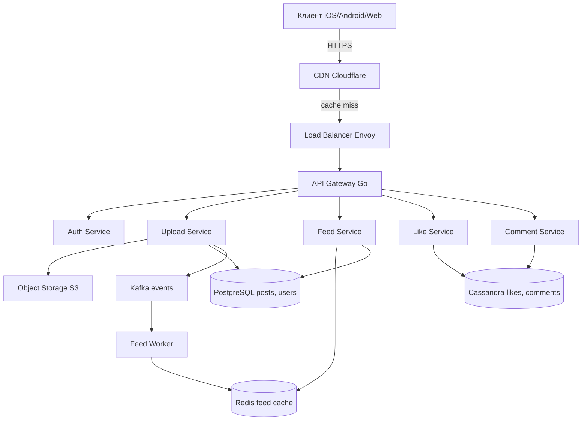

# Проектирование «Можнограмм» (аналог Instagram)

**Задача:** спроектировать систему для публикации фотографий с лентой друзей, лайками и комментариями.

---

## 1. Выяснение требований

### Функциональные
- **Публикация фото:** загрузка изображения + подпись → сохранение, генерация превью
- **Лента:** пользователь видит публикации подписок в хронологическом порядке (последние 50–100 постов)
- **Лайки:** счётчик лайков, список пользователей, кто лайкнул
- **Комментарии:** текст, автор, время, отображаются под постом

### Нефункциональные
- **Масштаб:** 500 млн пользователей, 100 млн DAU (daily active users)
- **Нагрузка:**
  - Читать ленту: 100 млн × 10 раз/день = 1 млрд запросов/день ≈ **12k RPS**
  - Публиковать фото: 100 млн × 1 фото/день = 100 млн загрузок/день ≈ **1.2k uploads/sec** (пик 5k)
  - Лайки: 100 млн × 50 лайков/день = 5 млрд лайков/день ≈ **60k writes/sec**
- **Доступность:** 99.9% (несколько минут простоя в год допустимо, но лента критична)
- **Консистентность:** eventual — задержка 1–2 сек для отображения нового поста в ленте друзей допустима
- **Задержка:** лента открывается за 300 мс (P95)

---

## 2. Оценка нагрузки (back-of-the-envelope)

### Хранилище фото
- 100 млн постов/день × 2 МБ (оригинал) = **200 ТБ/день**
- За год: 200 ТБ × 365 = **73 ПБ/год**
- Превью (500×500): 100 млн × 50 КБ = **5 ТБ/день превью**

### Трафик чтения ленты
- 1 млрд запросов ленты/день
- Каждая лента: 50 постов × 50 КБ превью = 2.5 МБ
- **2.5 ПБ/день** исходящего трафика (без CDN)
- С CDN hit rate 90% → origin отдаёт 250 ТБ/день ≈ **3 ГБ/с**

### База данных
- **Посты:** 100 млн/день × 500 байт метаданных = **50 ГБ/день**
- **Лайки:** 5 млрд/день × 16 байт (post_id + user_id) = **80 ГБ/день**
- **Комментарии:** 500 млн/день × 200 байт = **100 ГБ/день**

---

## 3. Компоненты системы



---

## 4. Детальный разбор компонентов

### 4.1 Upload Service (публикация фото)
**Задача:** загрузка фото, генерация превью, сохранение метаданных.

**Поток:**
1. Клиент → Upload Service: POST `/api/upload` + изображение (multipart)
2. Upload Service → S3: сохранить оригинал (`s3://photos/{user_id}/{post_id}/original.jpg`)
3. Генерация превью (500×500, 1080×1080) → S3
4. Метаданные (post_id, user_id, caption, timestamp, URLs) → PostgreSQL `posts` таблица
5. Событие `PostCreated` → Kafka

**Выбор технологий:**
- **S3 (или аналог):** бесконечное хранилище, репликация, дешевле дисков
- **PostgreSQL:** метаданные постов — структурированные данные с индексами (по user_id, timestamp)
- **Kafka:** асинхронная доставка события в Feed Worker для обновления лент подписчиков

---

### 4.2 Feed Service (лента)
**Задача:** отдать 50 последних постов подписок пользователя.

**Проблема:** наивный подход — запрос всех постов подписок, сортировка по времени — дорого (JOIN по 1000 подписок × 100 постов каждый).

**Решение: Fan-out on write (предварительная сборка ленты)**

**Как работает:**
1. Пользователь публикует пост → событие `PostCreated` → Kafka
2. **Feed Worker** читает событие:
   - Достаёт список подписчиков автора из БД (таблица `followers`)
   - Для каждого подписчика добавляет `post_id` в Redis sorted set:
     ```
     ZADD feed:{user_id} {timestamp} {post_id}
     ZREMRANGEBYRANK feed:{user_id} 0 -101  // храним только 100 последних
     ```
3. Когда пользователь запрашивает ленту:
   ```
   ZREVRANGE feed:{user_id} 0 49  // последние 50 post_id
   ```
4. Запрос метаданных постов одним batch-запросом: `SELECT * FROM posts WHERE post_id IN (...)`

**Trade-offs:**
- **✓ Быстрое чтение:** O(1) в Redis, одна БД-операция
- **✗ Дорогая запись:** если у автора 10 млн подписчиков, 10 млн записей в Redis. Для знаменитостей — гибрид (fan-out для обычных, on-demand для VIP)

**Альтернатива — Fan-out on read:**
Лента собирается при запросе:
```sql
SELECT * FROM posts 
WHERE user_id IN (SELECT following_id FROM followers WHERE user_id = :me)
ORDER BY created_at DESC LIMIT 50;
```
- **✓ Простая запись**
- **✗ Медленное чтение** (JOIN по 1000 подписок)

Для 100 млн DAU fan-out on write с Redis выигрывает.

---

### 4.3 Like Service (лайки)
**Задача:** 60k writes/sec, миллиарды записей.

**Выбор БД: Cassandra**
- **Высокая скорость записи** (LSM-tree)
- **Линейное масштабирование** (добавить ноды → пропускная способность растёт)
- **Eventual consistency** допустима (задержка отображения лайка 1–2 сек — OK)

**Схема данных:**
```cql
CREATE TABLE likes (
    post_id UUID,
    user_id UUID,
    created_at TIMESTAMP,
    PRIMARY KEY (post_id, user_id)
);
```

Запросы:
- Лайкнуть: `INSERT INTO likes (post_id, user_id, created_at) VALUES (...)`
- Счётчик: `SELECT COUNT(*) FROM likes WHERE post_id = :id` (медленно) → кэш в Redis
- Список лайков: `SELECT user_id FROM likes WHERE post_id = :id LIMIT 100`

**Оптимизация счётчика:**
- Денормализация: поле `likes_count` в `posts` (PostgreSQL)
- Обновление через Kafka event stream:
  ```
  PostLiked → Like Service → Kafka → Counter Worker → UPDATE posts SET likes_count = likes_count + 1
  ```

---

### 4.4 Comment Service (комментарии)
Аналогично лайкам, но с текстом:
```cql
CREATE TABLE comments (
    post_id UUID,
    comment_id TIMEUUID,
    user_id UUID,
    text TEXT,
    created_at TIMESTAMP,
    PRIMARY KEY (post_id, comment_id)
) WITH CLUSTERING ORDER BY (comment_id DESC);
```

**TIMEUUID** — автоматическая сортировка по времени.

---

### 4.5 CDN (Cloudflare)
**Задача:** снизить latency и разгрузить origin.

**Что кэшируется:**
- Превью изображений (`/media/{post_id}/thumb.jpg`) — TTL 7 дней
- Статика фронтенда (JS, CSS) — TTL 1 год (versioned URL)

**Что НЕ кэшируется:**
- Лента (`/api/feed`) — персонализированная
- Лайки/комментарии — изменяются в реальном времени

**Инвалидация:** при удалении поста → CDN API purge по тегу `post:{post_id}`

---

## 5. Полиглот-персистентность

| Данные | БД | Почему |
|---|---|---|
| Посты (метаданные) | PostgreSQL | Структура стабильна, индексы по user_id/timestamp, ACID для целостности |
| Фото | S3 | Бесконечное масштабирование, репликация, CDN интеграция |
| Лента | Redis | O(1) чтение, sorted set для хронологии |
| Лайки/комментарии | Cassandra | Массивная запись (60k/sec), eventual consistency допустима |
| События | Kafka | Асинхронная обработка fan-out, счётчиков, аналитики |

---

## 6. Узкие места и решения

### 6.1 Fan-out для знаменитостей
**Проблема:** пост автора с 50 млн подписчиков → 50 млн записей в Redis → задержка минуты.

**Решение:**
- **VIP-список:** авторы с >1 млн подписчиков
- Для VIP — **fan-out on read** (лента собирается при запросе):
  ```
  // Обычные подписки — из Redis
  // VIP-подписки — SELECT * FROM posts WHERE user_id IN (:vip_ids) ORDER BY created_at DESC LIMIT 10
  // Merge в памяти
  ```

### 6.2 Горячие посты (cache stampede)
**Проблема:** пост набрал 1 млн просмотров/мин → все читают счётчик лайков → 16k RPS к Cassandra.

**Решение:**
- Кэш счётчиков в Redis (TTL 10 сек)
- Lease-based caching: только один запрос идёт в БД при miss, остальные ждут

### 6.3 Согласованность счётчиков
**Проблема:** eventual consistency Cassandra + кэш Redis → пользователь лайкнул, видит старый счётчик.

**Решение:**
- Оптимистичное обновление UI: `likes_count++` локально в клиенте сразу
- Backend обновляет Redis асинхронно через Kafka (задержка <1 сек)

---

## 7. Масштабирование

### Горизонтальное
- **API Gateway, Upload, Feed Services:** stateless → добавить инстансы за LB
- **PostgreSQL:** read replicas для чтения метаданных постов; sharding по `user_id` для записи
- **Cassandra:** добавить ноды → consistent hashing автоматически распределит данные
- **Redis:** Redis Cluster (16k слотов, шардирование по ключу `feed:{user_id}`)

### Регионы
- **Multi-region S3:** фото реплицируются в US, EU, APAC → latency <100 мс
- **CDN:** автоматически кэширует в ближайшем PoP
- **БД:** master в US, read replicas в регионах (eventual consistency допустима для ленты)

---

## 8. Мониторинг и SLO

**Ключевые метрики:**
- **Feed latency P95 < 300 мс**
- **Upload success rate > 99.5%**
- **Redis hit rate > 95%** (если ниже → увеличить TTL или память)
- **Cassandra write latency P99 < 50 мс**

**Алерты:**
- Feed Worker lag > 10 сек → автоскейлинг воркеров
- S3 upload failures > 1% → переключение на backup region
- Redis memory > 80% → добавить ноды в cluster

---

## 9. Итоговая архитектура

**Strengths:**
- Fan-out on write → быстрая лента (O(1))
- Полиглот-персистентность → каждая БД под свою нагрузку
- CDN → latency <100 мс для фото
- Kafka → асинхронная обработка без блокировки API

**Trade-offs:**
- Eventual consistency — лайк отображается с задержкой 1–2 сек
- Сложность fan-out для VIP — требует гибридного подхода
- Высокая стоимость хранилища (73 ПБ/год S3 ≈ $1.5M/год только за хранение)

**Альтернативы:**
- MongoDB вместо PostgreSQL для метаданных (гибкая схема, но слабее ACID)
- DynamoDB вместо Cassandra (managed, но дороже и сложнее запросы)
- GraphQL Federation вместо монолитного API Gateway (для микросервисов)

---

## 10. Расширения (вне MVP)

- **Stories** (24-часовой контент): отдельная таблица с TTL в Cassandra
- **Direct Messages:** WebSocket + отдельный сервис с PostgreSQL (нужны ACID-транзакции)
- **Рекомендации:** ML-модель ранжирования ленты (не хронология, а релевантность) → Kafka Streams + TensorFlow Serving
- **Видео:** транскодирование (FFmpeg на EC2 Spot), adaptive bitrate (HLS), отдельное CDN
