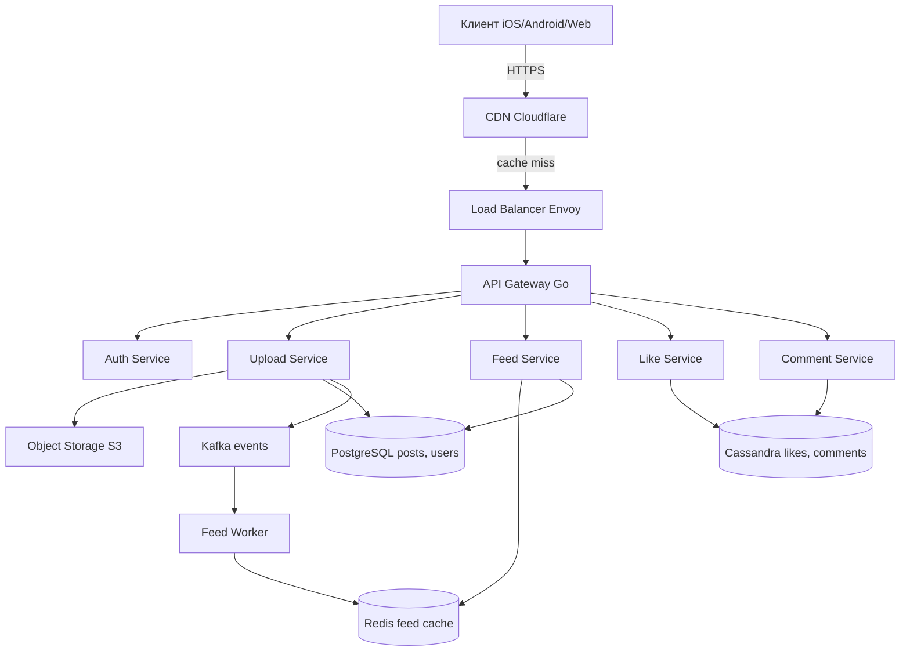

# Проектирование Instagram

**Задача:** спроектировать систему для публикации фотографий с лентой друзей, лайками и комментариями.

---

## 1. Выяснение требований

### Функциональные
- **Публикация фото:** загрузка изображения + подпись → сохранение, генерация превью
- **Лента:** пользователь видит публикации подписок в хронологическом порядке (последние 50–100 постов)
- **Лайки:** счётчик лайков, список пользователей, кто лайкнул
- **Комментарии:** текст, автор, время, отображаются под постом

### Нефункциональные
- **Масштаб:** 500 млн пользователей, 100 млн DAU (daily active users)
- **Нагрузка:**
  - Читать ленту: 100 млн × 10 раз/день = 1 млрд запросов/день ≈ **12k RPS**
  - Публиковать фото: 100 млн × 1 фото/день = 100 млн загрузок/день ≈ **1.2k uploads/sec** (пик 5k)
  - Лайки: 100 млн × 50 лайков/день = 5 млрд лайков/день ≈ **60k writes/sec**
- **Доступность:** 99.9% (несколько минут простоя в год допустимо, но лента критична)
- **Консистентность:** eventual — задержка 1–2 сек для отображения нового поста в ленте друзей допустима
- **Задержка:** лента открывается за 300 мс (P95)

---

## 2. Оценка нагрузки (back-of-the-envelope)

### Хранилище фото
- 100 млн постов/день × 2 МБ (оригинал) = **200 ТБ/день**
- За год: 200 ТБ × 365 = **73 ПБ/год**
- Превью (500×500): 100 млн × 50 КБ = **5 ТБ/день превью**

### Трафик чтения ленты
- 1 млрд запросов ленты/день
- Каждая лента: 50 постов × 50 КБ превью = 2.5 МБ
- **2.5 ПБ/день** исходящего трафика (без CDN)
- С CDN hit rate 90% → origin отдаёт 250 ТБ/день ≈ **3 ГБ/с**

### База данных
- **Посты:** 100 млн/день × 500 байт метаданных = **50 ГБ/день**
- **Лайки:** 5 млрд/день × 16 байт (post_id + user_id) = **80 ГБ/день**
- **Комментарии:** 500 млн/день × 200 байт = **100 ГБ/день**

---

## 3. Компоненты системы



---

## 4. Детальный разбор компонентов

### 4.1 Upload Service (публикация фото)
**Задача:** загрузка фото/видео, генерация превью, сохранение метаданных.

#### Проблема наивного подхода
Загрузка большого файла (видео 100 МБ) в одном POST-запросе:
- ❌ Обрыв связи → загрузка с начала
- ❌ API-сервер простаивает минуту, пропуская файл в S3
- ❌ Нет прогресс-бара для пользователя

#### Решение: Presigned URL + Multipart Upload

**Поток (двухэтапная загрузка):**

**Шаг 1 — инициализация:**
1. Клиент → Upload Service: `POST /api/posts/upload-init` (caption, media_type)
2. Upload Service генерирует `post_id`, создаёт запись в БД (статус `uploading`)
3. Upload Service → S3: `CreateMultipartUpload` → получает `upload_id`
4. Upload Service возвращает клиенту:
   - `post_id`
   - **Presigned URL** для каждой части (part 1–20, каждая 5 МБ)
   - `upload_id`

**Presigned URL** — временный URL (валиден 15 мин) с правами на PUT одной части файла, без аутентификации клиента в AWS.

**Шаг 2 — загрузка:**
1. Клиент разбивает файл на части (5 МБ каждая)
2. **Параллельная загрузка** каждой части напрямую в S3 по presigned URL:
   ```
   PUT https://s3.../part1?uploadId=abc&partNumber=1
   PUT https://s3.../part2?uploadId=abc&partNumber=2
   ...
   ```
3. S3 возвращает `ETag` для каждой части
4. Клиент → Upload Service: `POST /api/posts/upload-complete` (post_id, ETags[])
5. Upload Service → S3: `CompleteMultipartUpload` → собирает части в один файл
6. Асинхронно: генерация превью (500×500, 1080×1080) через воркер
7. Обновление БД: статус `completed`, URL превью
8. Событие `PostCreated` → Kafka → Feed Worker

**Преимущества:**
- ✓ **Возобновляемая загрузка** — при обрыве перезагрузить только потерянные части
- ✓ **Параллельность** — 20 частей × 5 МБ = 100 МБ за время загрузки одной части
- ✓ **Разгрузка API** — файл идёт напрямую в S3, API только координирует
- ✓ **Прогресс** — клиент знает, сколько частей загружено

**Выбор технологий:**
- **S3 Multipart Upload:** до 10k частей, каждая до 5 ГБ → максимальный файл 5 ТБ
- **PostgreSQL vs DynamoDB:**
  - **PostgreSQL:** ACID, сложные JOIN (посты + подписчики), знакомая всем SQL
  - **DynamoDB:** автомасштабирование, нет лимита по RPS, но сложнее запросы (нужен GSI для каждого pattern)
  - **Выбор:** PostgreSQL для MVP (проще разработка), DynamoDB при >100k QPS и шардировании
- **Kafka:** асинхронная обработка (fan-out, превью, аналитика)

---

### 4.2 Feed Service (лента)
**Задача:** отдать 50 последних постов подписок пользователя.

**Проблема:** наивный подход — запрос всех постов подписок, сортировка по времени — дорого (JOIN по 1000 подписок × 100 постов каждый).

**Решение: Fan-out on write (предварительная сборка ленты) с гибридным подходом**

#### Наивное решение (Fan-out on read)
При запросе ленты:
```sql
SELECT * FROM posts 
WHERE user_id IN (SELECT following_id FROM followers WHERE user_id = :me)
ORDER BY created_at DESC LIMIT 50;
```
- ✓ Простая запись (просто INSERT в posts)
- ✗ **Медленное чтение:** JOIN по 1000 подписок × 100 постов каждый = сканирование 100k строк
- ✗ При 12k RPS чтения ленты → БД не справится

#### Fan-out on write (основное решение)
**Как работает:**
1. Пользователь публикует пост → событие `PostCreated` → Kafka
2. **Feed Worker** читает событие:
   - Достаёт список подписчиков автора из БД (таблица `followers`)
   - Для каждого подписчика добавляет `post_id` в Redis sorted set:
     ```
     ZADD feed:{user_id} {timestamp} {post_id}
     ZREMRANGEBYRANK feed:{user_id} 0 -101  // храним только 100 последних
     ```
3. Когда пользователь запрашивает ленту:
   ```
   ZREVRANGE feed:{user_id} 0 49  // последние 50 post_id
   ```
4. Запрос метаданных постов одним batch-запросом: `SELECT * FROM posts WHERE post_id IN (...)`

**Trade-offs:**
- ✓ **Быстрое чтение:** O(1) в Redis, одна БД-операция
- ✗ **Дорогая запись:** если у автора 10 млн подписчиков, 10 млн записей в Redis

#### Гибридный подход (для знаменитостей)

**Проблема:** пост автора с 50 млн подписчиков → 50 млн записей в Redis → задержка минуты, Feed Worker не успевает.

**Решение:**
1. **VIP-порог:** авторы с >1 млн подписчиков помечаются как VIP
2. **Для обычных авторов:** fan-out on write (предварительная сборка в Redis)
3. **Для VIP:** fan-out on read (лента собирается при запросе)

**Алгоритм формирования ленты:**
```
// Шаг 1: получить подписки пользователя
normal_authors = SELECT following_id FROM followers WHERE user_id = :me AND is_vip = false
vip_authors = SELECT following_id FROM followers WHERE user_id = :me AND is_vip = true

// Шаг 2: Redis — лента от обычных авторов (уже готова)
normal_posts = ZREVRANGE feed:{user_id} 0 49  // O(log N)

// Шаг 3: БД — последние посты VIP (on-demand)
vip_posts = SELECT * FROM posts 
            WHERE user_id IN (:vip_authors) 
            ORDER BY created_at DESC LIMIT 10

// Шаг 4: merge в памяти по timestamp
merged = merge_sort(normal_posts, vip_posts)[:50]
```

**Когда пользователь подписывается на VIP:**
- НЕ добавляем 10k постов VIP в его ленту (дорого)
- Просто записываем `is_vip = true` в таблицу `followers`
- При запросе ленты посты VIP подтянутся on-demand

**Порог 1 млн подписчиков:**
- Если <1М подписчиков → 1М записей в Redis при публикации → Feed Worker успевает за ~10 сек
- Если >1М → слишком долго, переключаем на on-demand

**Trade-offs:**
- ✓ Быстрая запись для VIP (нет fan-out)
- ✓ Лента пользователя всё равно собирается за <300 мс (обычные из Redis, VIP из БД с индексом)
- ✗ Немного сложнее логика (два источника данных)

#### Альтернатива — Fan-out on read для всех
Если бы мы делали fan-out on read для всех:
- Запрос ленты: JOIN по 1000 подписок → 100k строк → 500+ мс даже с индексами
- Нужен кэш результата в Redis, но инвалидация сложнее (каждый новый пост инвалидирует ленты 10k подписчиков)

Для 100 млн DAU **fan-out on write с гибридом** выигрывает.

---

### 4.3 Like Service (лайки)
**Задача:** 60k writes/sec, миллиарды записей.

**Выбор БД: Cassandra**
- **Высокая скорость записи** (LSM-tree)
- **Линейное масштабирование** (добавить ноды → пропускная способность растёт)
- **Eventual consistency** допустима (задержка отображения лайка 1–2 сек — OK)

**Схема данных:**
```cql
CREATE TABLE likes (
    post_id UUID,
    user_id UUID,
    created_at TIMESTAMP,
    PRIMARY KEY (post_id, user_id)
);
```

Запросы:
- Лайкнуть: `INSERT INTO likes (post_id, user_id, created_at) VALUES (...)`
- Счётчик: `SELECT COUNT(*) FROM likes WHERE post_id = :id` (медленно) → кэш в Redis
- Список лайков: `SELECT user_id FROM likes WHERE post_id = :id LIMIT 100`

**Оптимизация счётчика:**
- Денормализация: поле `likes_count` в `posts` (PostgreSQL)
- Обновление через Kafka event stream:
  ```
  PostLiked → Like Service → Kafka → Counter Worker → UPDATE posts SET likes_count = likes_count + 1
  ```

---

### 4.4 Comment Service (комментарии)
Аналогично лайкам, но с текстом:
```cql
CREATE TABLE comments (
    post_id UUID,
    comment_id TIMEUUID,
    user_id UUID,
    text TEXT,
    created_at TIMESTAMP,
    PRIMARY KEY (post_id, comment_id)
) WITH CLUSTERING ORDER BY (comment_id DESC);
```

**TIMEUUID** — автоматическая сортировка по времени.

---

### 4.5 CDN (Cloudflare)
**Задача:** снизить latency и разгрузить origin.

**Что кэшируется:**
- Превью изображений (`/media/{post_id}/thumb.jpg`) — TTL 7 дней
- Статика фронтенда (JS, CSS) — TTL 1 год (versioned URL)

**Что НЕ кэшируется:**
- Лента (`/api/feed`) — персонализированная
- Лайки/комментарии — изменяются в реальном времени

**Инвалидация:** при удалении поста → CDN API purge по тегу `post:{post_id}`

---

## 5. Полиглот-персистентность

| Данные | БД | Почему |
|---|---|---|
| Посты (метаданные) | PostgreSQL | Структура стабильна, индексы по user_id/timestamp, ACID для целостности |
| Фото | S3 | Бесконечное масштабирование, репликация, CDN интеграция |
| Лента | Redis | O(1) чтение, sorted set для хронологии |
| Лайки/комментарии | Cassandra | Массивная запись (60k/sec), eventual consistency допустима |
| События | Kafka | Асинхронная обработка fan-out, счётчиков, аналитики |

### 5.1 PostgreSQL vs. DynamoDB для метаданных

Основной спор в этой задаче — какая БД держит посты, подписки и пользователей. Оба варианта рабочие, вопрос в том, **что вам дороже: скорость разработки или предсказуемость на масштабе**.

| Критерий | PostgreSQL | DynamoDB |
|---|---|---|
| **Модель** | Реляционная, таблицы + JOIN | Key-value / документная, доступ только по ключу |
| **Запросы** | Любые: `WHERE`, `JOIN`, агрегации, `ORDER BY` | Только по partition key (+ sort key). Каждый новый паттерн — новый GSI |
| **Согласованность** | Строгая (ACID), read replicas с lag | Eventual по умолчанию, `ConsistentRead` в 2× дороже |
| **Масштабирование записи** | Вертикально + шардирование вручную | Горизонтально, автоматически, без потолка |
| **Потолок одной ноды** | ~10–50k QPS с индексами | Фактически нет (partition key решает) |
| **Latency** | 1–5 мс в регионе | Single-digit мс, стабильно под нагрузкой |
| **Стоимость** | Фиксированная (инстанс) | Pay-per-request: чтения/записи тарифицируются |
| **Сложность разработки** | Низкая, все знают SQL | Высокая: нужно проектировать access patterns заранее |
| **Миграции схемы** | `ALTER TABLE`, онлайн | Нет схемы, но менять ключи — переливка данных |
| **Кто использует** | Instagram (изначально), Shopify | Amazon, Discord (раньше), Lyft |

**Что важно понимать про DynamoDB:** вы проектируете не «схему данных», а «список запросов». Нужен «все посты пользователя X по времени» — таблица с `PK=userId, SK=createdAt`. Нужен «все посты по хештегу» — ещё одна таблица или GSI с `PK=hashtag`. Заранее неизвестный запрос = полное сканирование = дорого.

**Что важно понимать про PostgreSQL:** 10 ТБ и 20k QPS на одной машине — это норма для 2026. Шардирование по `user_id` добавляет распределённые JOIN и двухфазные коммиты, то есть ломает главное преимущество SQL.

**Выбор для этой задачи:**

- **MVP и до ~50k QPS** → **PostgreSQL**. Метаданные постов — структурированные, связи (user → post → follow) естественные, аналитика и отладка тривиальны. Read replicas закрывают чтение, запись в 1.2k uploads/sec держит одна нода.
- **При росте до 100k+ QPS и мультирегионе** → **DynamoDB** (или Cassandra). Fan-out и лента уже живут в Redis, так что метаданные читаются по `post_id` — это ровно тот паттерн, где key-value раскрывается.

**Практичный гибрид:** PostgreSQL как source of truth для постов и подписок + денормализованная копия в DynamoDB для чтения ленты по `post_id` при высоком QPS. Дороже в эксплуатации, но каждая БД делает то, что умеет.

---

## 6. Узкие места и решения

### 6.1 Fan-out для знаменитостей
**Проблема:** пост автора с 50 млн подписчиков → 50 млн записей в Redis → задержка минуты.

**Решение:**
- **VIP-список:** авторы с >1 млн подписчиков
- Для VIP — **fan-out on read** (лента собирается при запросе):
  ```
  // Обычные подписки — из Redis
  // VIP-подписки — SELECT * FROM posts WHERE user_id IN (:vip_ids) ORDER BY created_at DESC LIMIT 10
  // Merge в памяти
  ```

### 6.2 Горячие посты (cache stampede)
**Проблема:** пост набрал 1 млн просмотров/мин → все читают счётчик лайков → 16k RPS к Cassandra.

**Решение:**
- Кэш счётчиков в Redis (TTL 10 сек)
- Lease-based caching: только один запрос идёт в БД при miss, остальные ждут

### 6.3 Согласованность счётчиков
**Проблема:** eventual consistency Cassandra + кэш Redis → пользователь лайкнул, видит старый счётчик.

**Решение:**
- Оптимистичное обновление UI: `likes_count++` локально в клиенте сразу
- Backend обновляет Redis асинхронно через Kafka (задержка <1 сек)

---

## 7. Масштабирование

### Горизонтальное
- **API Gateway, Upload, Feed Services:** stateless → добавить инстансы за LB
- **PostgreSQL:** read replicas для чтения метаданных постов; sharding по `user_id` для записи
- **Cassandra:** добавить ноды → consistent hashing автоматически распределит данные
- **Redis:** Redis Cluster (16k слотов, шардирование по ключу `feed:{user_id}`)

### Регионы
- **Multi-region S3:** фото реплицируются в US, EU, APAC → latency <100 мс
- **CDN:** автоматически кэширует в ближайшем PoP
- **БД:** master в US, read replicas в регионах (eventual consistency допустима для ленты)

---

## 8. Мониторинг и SLO

**Ключевые метрики:**
- **Feed latency P95 < 300 мс**
- **Upload success rate > 99.5%**
- **Redis hit rate > 95%** (если ниже → увеличить TTL или память)
- **Cassandra write latency P99 < 50 мс**

**Алерты:**
- Feed Worker lag > 10 сек → автоскейлинг воркеров
- S3 upload failures > 1% → переключение на backup region
- Redis memory > 80% → добавить ноды в cluster

---

## 9. Итоговая архитектура

**Strengths:**
- Fan-out on write → быстрая лента (O(1))
- Полиглот-персистентность → каждая БД под свою нагрузку
- CDN → latency <100 мс для фото
- Kafka → асинхронная обработка без блокировки API

**Trade-offs:**
- Eventual consistency — лайк отображается с задержкой 1–2 сек
- Сложность fan-out для VIP — требует гибридного подхода
- Высокая стоимость хранилища (73 ПБ/год S3 ≈ $1.5M/год только за хранение)

**Альтернативы:**
- MongoDB вместо PostgreSQL для метаданных (гибкая схема, но слабее ACID)
- DynamoDB вместо Cassandra (managed, но дороже и сложнее запросы)
- GraphQL Federation вместо монолитного API Gateway (для микросервисов)

---

## 10. Расширения (вне MVP)

- **Stories** (24-часовой контент): отдельная таблица с TTL в Cassandra
- **Direct Messages:** WebSocket + отдельный сервис с PostgreSQL (нужны ACID-транзакции)
- **Рекомендации:** ML-модель ранжирования ленты (не хронология, а релевантность) → Kafka Streams + TensorFlow Serving
- **Видео:** транскодирование (FFmpeg на EC2 Spot), adaptive bitrate (HLS), отдельное CDN