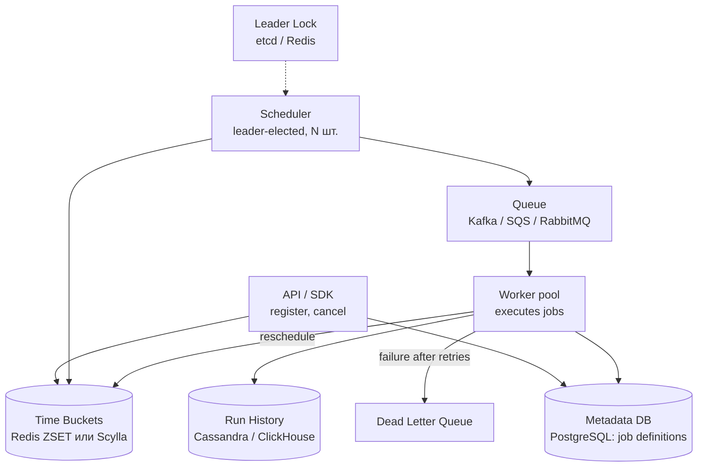

# Проектирование планировщика задач (Job Scheduler)

**Задача:** сервис, который выполняет задачи по расписанию («каждый день в 3:00») или с задержкой («через 5 минут»), надёжно и в масштабе.

---

## 1. Требования

### Функциональные
- Задачи с cron-расписанием (`0 3 * * *`)
- Одноразовые отложенные задачи (`at 2026-11-17T10:00Z`)
- Повторяющиеся с интервалом (`every 30s`, с ограничением числа запусков)
- Гарантия запуска, повтор при сбое, отмена
- Приоритеты, таймауты, идемпотентность
- История запусков и статусы

**За рамками:** UI, workflow-движок (DAG между задачами), распределённые транзакции.

### Нефункциональные
- **Масштаб:** 100 млн зарегистрированных задач, **1 млн запусков в минуту** ≈ 16k exec/сек
- **Точность:** точка запуска ±1 сек
- **Гарантия:** **at-least-once** (дубли допустимы, потери — нет). Exactly-once невозможен в распределённой системе; вместо этого — идемпотентность на стороне исполнителя
- **Доступность:** 99.95% — если планировщик лёг, задачи не выполняются
- **Durability:** задача не должна теряться после подтверждения регистрации

---

## 2. Ключевое решение: как хранить и искать «что запускать сейчас»

### Наивно (и как делают все поначалу)
Таблица `jobs(next_run_at)` + опрос `SELECT * WHERE next_run_at <= now()` каждую секунду.
- ✓ Просто
- ✗ При 100 млн задач даже с индексом — постоянный скан, и это `SELECT` в цикле
- ✗ При N инстансах планировщика все опрашивают одну таблицу → конкуренция

### Практичное: time-bucketed индексы + очередь на «ближайшую минуту»

Разбиваем время на **бакеты по минутам**. Каждый бакет — отдельный ключ в хранилище.

```
bucket:2026-11-16T10:03 → [job_id_1, job_id_2, ...]
```

**Поток:**
1. При регистрации задачи вычисляем `next_run_at`, кладём `job_id` в бакет этой минуты
2. Каждую секунду планировщик читает бакет текущей минуты (и следующей, для упреждения)
3. Задача из бакета → в очередь исполнения → воркеры берут и выполняют
4. После выполнения пересчитываем `next_run_at` и кладём в следующий бакет (для повторяющихся)

- ✓ Один `GET` на бакет вместо скана таблицы
- ✓ Естественно шардируется по времени
- ✓ Пропущенные бакеты (планировщик лежал) можно «догнать» при старте

**Хранение бакетов:** Sorted Set в Redis (`ZADD bucket:{ts} score job_id`), либо отдельная таблица в БД с партиционированием по времени.

---

## 3. Архитектура



### Роли компонентов

**Scheduler (планировщик)** — «читает время и кладёт задачи в очередь». Не выполняет задачи. Stateless по сути, но нужен **leader election**: только лидер читает бакеты, иначе N инстансов выдадут одну задачу N раз.

**Queue** — буфер между «пора запускать» и «воркер свободен». Даёт: backpressure, retry, приоритеты, видимость.

**Worker** — исполняет. Горизонтально масштабируется по длине очереди.

---

## 4. Детали компонентов

### 4.1 Leader election — почему нужен один лидер

Если три инстанса планировщика одновременно прочитают бакет `10:03`, каждая задача попадёт в очередь трижды.

**Варианты:**
- **etcd/ZooKeeper lease:** лидер держит lease (TTL 10 сек), продлевает каждые 3 сек. Потерял lease → немедленно прекращает работу (иначе split-brain).
- **Redis `SET lock NX PX 10000`** + продление: проще, но при split-brain два лидера возможны.
- **Без лидера, но с идемпотентной вставкой:** каждая задача вставляется с ключом `(job_id, scheduled_ts)`, `ON CONFLICT DO NOTHING`. Дубли отсекаются на уровне БД. **Это надёжнее**, чем полагаться только на лидера.

**На практике используют оба механизма:** leader election сокращает лишнюю работу, уникальный ключ гарантирует корректность.

### 4.2 Гарантия at-least-once и идемпотентность

**Проблема:** воркер взял задачу, выполнил, но упал до подтверждения → задача вернётся в очередь → выполнится дважды.

**Что делает планировщик:**
- **Visibility timeout:** задача «невидима» другим воркерам N секунд. Не подтвердил за N → возвращается.
- **Максимум попыток:** после K неудач → DLQ (Dead Letter Queue) + алерт.

**Что делает исполнитель (обязан!):**
- **Idempotency key** = `(job_id, scheduled_ts)`. Исполнитель проверяет: «эту работу я уже делал?». Примеры:
  - Отправка письма → таблица `sent_emails(idempotency_key UNIQUE)`
  - Списание денег → `idempotency_key` в платёжном провайдере
  - Запись в БД → `INSERT ... ON CONFLICT DO NOTHING` или upsert

**Правило для интервью:** планировщик может гарантировать только at-least-once. Exactly-once — забота бизнес-логики, и это не «недостаток», а фундаментальное свойство распределённых систем.

### 4.3 Retry с экспоненциальным backoff

```
delay = min(max_delay, base × 2^attempt) × random(0.8, 1.2)
```

**Jitter обязателен:** без него 10 000 задач, упавших одновременно (например, из-за недоступности внешнего API), через 2^n секунд синхронно ударят снова и добьют сервис.

**Классификация ошибок:**
- **Retryable** (таймаут, 503, сеть) → retry с backoff
- **Non-retryable** (400, невалидные данные) → сразу в DLQ, не тратить попытки
- **Потеря соединения с воркером** → задача возвращается в очередь, но это не «попытка» (иначе одна и та же задача сожжёт все попытки)

### 4.4 Расписание: cron и его ловушки

**Cron-выражение** — 5 полей: `minute hour day-of-month month day-of-week`.

Ловушки:
1. **Часовые пояса:** `0 3 * * *` — 3:00 в чьём поясе? Хранить `timezone` вместе с задачей. DST: в ночь перевода часов 2:30 может не существовать или существовать дважды.
2. **Пропущенные окна:** сервис лежал с 2:55 до 3:15 → задача «3:00» не запустилась. Политика:
   - `skip` — пропустить, ждать следующего окна (для «отправить дайджест» это плохо)
   - `run_once` — выполнить один раз при восстановлении (обычный выбор)
   - `run_all` — выполнить все пропущенные (для «обработать дневную выгрузку» может быть нужно)
3. **Повторяющиеся с интервалом** нужно считать от `scheduled_ts`, а не от `now()` — иначе дрейф: задача «каждые 60 сек» при задержке выполнения 2 сек постепенно уезжает.

### 4.5 Хранение определений задач

**PostgreSQL:** `jobs(id, name, type, cron, timezone, payload, next_run_at, status, retry_policy, timeout, created_by)`.

- 100 млн строк × ~1 КБ = 100 ГБ — нормально для PostgreSQL с партиционированием по `status` (активные/архив) и индексом по `next_run_at`
- Регулярные задачи хранятся как **одна строка** с пересчитываемым `next_run_at`, а не как N будущих записей (иначе 100 млн × 365 дней = взрыв)

**История запусков** — отдельно, в Cassandra/ClickHouse: 1 млн запусков/мин × 1440 = 1.4 млрд строк/день. Партиция `(job_id, date)`, TTL 90 дней.

### 4.6 Таймауты и «зависшие» задачи

Задача сломала воркер и висит вечно.
- `timeout` в определении задачи (например 5 мин)
- Воркер убивает себя ОС-сигналом по таймауту и репортит failure
- **Heartbeat:** пока задача выполняется, воркер продлевает «видимость» задачи в очереди. Нет heartbeat N секунд → планировщик считает воркер мёртвым (не задачу провалившейся, а именно воркер) и возвращает задачу в очередь

---

## 5. Узкие места

### 5.1 Полночный пик
90% cron-задач настроены на `0 0 * * *` или `0 3 * * *` (люди так пишут).
- 1 млн задач в одну минуту → 16k/сек при среднем в 16/сек
- **Причина — люди.** Решение продуктовое: рандомизировать `minute` при сохранении (`0 3 * * *` → `37 3 * * *`), объяснив пользователю «в течение часа»
- Технически: очередь сглаживает, но воркеров нужно в 100× больше на пик → дорого

### 5.2 «Каждые 5 секунд» × 10 000 пользователей
2 000 exec/сек только от этого. Часто задача тривиальна (проверить почту).
- **Минимальный интервал** (например 1 минута) — продуктовое ограничение
- **Batching:** 10 000 задач «проверить статус» → один воркер проверяет все разом батчами
- **Слияние:** задачи с одинаковым типом и payload объединяются

### 5.3 Долгие задачи (часы)
Транскодирование, отчёты — занимают воркер на часы, ломая «16k/сек».
- **Отдельные пулы воркеров:** короткие (1–10 сек) и длинные (минуты-часы) на разных очередях
- Долгие задачи часто лучше реализовать как «запустить внешний job» (K8s Job, AWS Batch), а планировщик только триггерит и мониторит

### 5.4 Отмена и изменение
Пользователь отменил задачу, которая уже в очереди.
- «Мягкая отмена»: флаг `cancelled` в БД, воркер проверяет перед запуском (дёшево, но задача уже в очереди)
- Отменить сообщение в Kafka нельзя → воркер обязан проверять статус
- Для «отменить и не выполнять» — таблица отмен в Redis, которую воркер проверяет в начале

### 5.5 Split-brain планировщика
Два лидера → дубли задач.
- Уникальный индекс `(job_id, scheduled_ts)` в таблице запусков (последняя линия)
- Fencing token: лидер с меньшим term не может писать в очередь

---

## 6. Что спрашивают на интервью

1. **«Как гарантировать, что задача не потеряется?»** — durable хранение до подтверждения + очередь с подтверждением + at-least-once.
2. **«Как гарантировать ровно один запуск?»** — нельзя; объяснить, почему, и предложить идемпотентность.
3. **«Как масштабировать на 1 млн/мин?»** — бакеты по времени вместо скана, шардирование очереди, отдельный пул для долгих задач.
4. **«Что если сервис лежал 5 минут?»** — политика догона (`skip` / `run_once` / `run_all`).
5. **«Как не запустить дважды при двух инстансах?»** — лидер + уникальный ключ в БД (а не только один из них).

---

## 7. Итог

| Аспект | Решение | Почему |
|---|---|---|
| Поиск «что запускать» | Бакеты по минутам в Redis ZSET | Один `GET` вместо скана 100 млн строк |
| Дубли | Leader election + `UNIQUE(job_id, scheduled_ts)` | Лидер для efficiency, ключ для корректности |
| Гарантия | at-least-once + идемпотентность исполнителя | Exactly-once невозможен |
| Retry | Экспоненциальный backoff с jitter | Без jitter — синхронные волны ударов |
| Определения | PostgreSQL, `next_run_at` + партиционирование | Повторяющаяся задача — одна строка |
| История | Cassandra/ClickHouse, TTL 90 дней | 1.4 млрд строк в день |
| Долгие задачи | Отдельный пул / внешние job-раннеры | Не блокировать короткие задачи |
| Таймауты | Heartbeat + visibility timeout | Отличать «воркер умер» от «задача медленная» |

**Главная мысль для интервью:** планировщик — это **две разные задачи**: «найти, что пора запускать» (индекс по времени, бакеты) и «надёжно выполнить» (очередь + at-least-once + идемпотентность). Смешивать их в одном опросном цикле — типичная ошибка. И обязательно проговорить, что exactly-once не существует, а идемпотентность — обязанность исполнителя.
