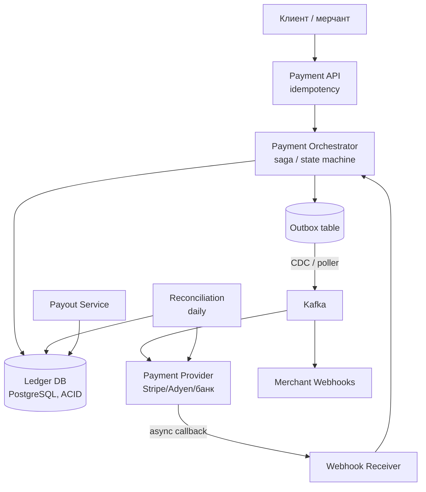

# Проектирование платёжной системы

**Задача:** принимать платежи, проводить их через внешние провайдеры и вести учёт денег так, чтобы баланс всегда сходился.

---

## 1. Требования

### Функциональные
- Приём платежа (карта, банковский перевод, кошелёк)
- Возвраты (полные и частичные)
- История транзакций и выписка
- Выплаты продавцам (payouts)
- Вебхуки для мерчантов о статусе

**За рамками:** подписки с биллингом, мультивалютная конвертация, кредиты, антифрод-скоринг (упоминается, но не проектируется).

### Нефункциональные
- **Масштаб:** 1 млн транзакций/день ≈ **12 TPS** (пик 100 TPS), 10 млн мерчантов
- **Latency:** синхронный ответ < 2 сек (это платёж, пользователь ждёт)
- **Доступность:** 99.99% — каждый час простоя = прямые потери
- **Консистентность:** **строгая**. Никаких «eventual»: деньги нельзя «слегка» потерять или «в основном» списать
- **Durability:** потеря подтверждённой транзакции недопустима (регуляторно)
- **Идемпотентность:** повторный запрос не должен списать дважды — это главное требование
- **Аудит:** каждая операция с деньгами должна быть восстановима и объяснима (требование комплаенса)

---

## 2. Ключевое отличие от других задач

**Здесь неверный ответ стоит денег реально.** Три принципа, которые надо проговорить сразу:

1. **Идемпотентность на каждом шаге.** Клиент может ретраить, сеть может дублировать, наш собственный сервис может перезапуститься. Двойное списание — самый частый баг в платежах.
2. **Никогда не хранить баланс как «единственное поле, которое UPDATE-ится».** Нужен журнал операций (ledger), из которого баланс вычисляется.
3. **Деньги — целые числа в минимальных единицах** (копейки, центы). Никогда `float`/`double`. `0.1 + 0.2 != 0.3` — это не шутка, это потерянные копейки в отчёте.

---

## 3. Двойная запись (double-entry ledger)

**Ошибка наивного подхода:** таблица `accounts(user_id, balance)`, при платеже `UPDATE balance = balance + 100`.

- Нет ответа на вопрос «почему такой баланс» — нет истории
- Нет проверки: если код ошибся и баланс неверен, вы не узнаете
- Невозможно аудиторское восстановление

**Правильный подход: журнал проводок (ledger)**

Каждая операция — **две** записи: дебет одного счёта и кредит другого. Сумма всех записей всегда 0.

```sql
CREATE TABLE ledger_entries (
    id              BIGSERIAL PRIMARY KEY,
    transaction_id  UUID NOT NULL,        -- группировка проводок
    account_id      BIGINT NOT NULL,
    direction       SMALLINT NOT NULL,    -- +1 debit, -1 credit
    amount_cents    BIGINT NOT NULL CHECK (amount_cents > 0),
    currency        CHAR(3) NOT NULL,
    created_at      TIMESTAMPTZ NOT NULL DEFAULT now()
);
```

**Платёж 1000 ₽ от клиента мерчанту:**
| transaction_id | account | direction | amount |
|---|---|---|---|
| t-1 | клиент | −1 (credit) | 1000 |
| t-1 | платформа:транзит | +1 (debit) | 1000 |

Затем, после комиссии 30 ₽:
| t-2 | платформа:транзит | −1 | 1000 |
| t-2 | мерчант | +1 | 970 |
| t-2 | платформа:комиссия | +1 | 30 |

**Проверка целостности (делается ежедневно):** `SELECT SUM(direction * amount_cents) FROM ledger_entries` = 0 для каждой валюты и каждого `transaction_id`.

Если не 0 — где-то баг, и это **алерт высшего приоритета**.

**Баланс** = `SUM(direction × amount) GROUP BY account_id`. Кэшируется в отдельной таблице `account_balances` (обновляется в той же транзакции), но source of truth — ledger.

**Почему это важно для интервью:** это то, что отличает «я читал про платежи» от «я понимаю платежи». Double-entry — 500-летняя бухгалтерская практика, и она единственная, которая проходит аудит.

---

## 4. Идемпотентность — центральная механика

### 4.1 Idempotency key от клиента

```
POST /payments
Idempotency-Key: 7f3a9c2e-...
{amount: 1000, currency: "RUB", merchant_id: 42}
```

**Правила:**
1. Клиент **обязан** прислать ключ (или мы генерируем на своей стороне из `(order_id, attempt)`)
2. Ключ хранится в таблице `idempotency_keys(key UNIQUE, request_hash, response, status, created_at)` с TTL 24 часа
3. Первый запрос: `INSERT ... ON CONFLICT DO NOTHING` → получилось → обрабатываем
4. Повторный запрос: `INSERT` не прошёл → читаем сохранённый ответ → **возвращаем тот же ответ**, не создаём вторую транзакцию
5. **Если первый запрос ещё в процессе** (`status=in_progress`) → возвращаем `409 Conflict` или `202 Accepted` с тем же request_id — клиент должен подождать, а не ретраить

**Тонкость:** ключ должен быть привязан к **телу запроса** (hash). Иначе клиент переиспользует ключ с другой суммой — получит чужой ответ. Проверка: `request_hash` совпадает? Нет → `422 Unprocessable` («idempotency key reused with different payload»).

### 4.2 Идемпотентность на каждом уровне

| Уровень | Механизм |
|---|---|
| Клиент → API | `Idempotency-Key` |
| API → внутренний сервис | `transaction_id` в заголовке, дедуп по нему |
| Сервис → БД | `UNIQUE (transaction_id, account_id, direction)` в ledger |
| Сервис → провайдер | ключ провайдера (у Stripe — свой `Idempotency-Key`), хранится до подтверждения |

**Ключевая проблема:** мы вызвали провайдера, он списал деньги, но ответ потерялся по сети. Что делать?
- Ретраить с **тем же** ключом идемпотентности провайдера → провайдер вернёт тот же результат
- **Никогда** не ретраить с новым ключом — это второе списание
- Пока ответ неизвестен, статус транзакции — `unknown`, **а не** `failed`. `failed` допустимо только при явном отказе провайдера.

---

## 5. Архитектура



### Поток платежа

1. `POST /payments` + `Idempotency-Key`
2. API: проверка ключа → создаём `payment` в статусе `pending`, пишем в ledger «транзит» (authorize)
3. Orchestrator: вызывает провайдера (или создаёт intent для клиентского SDK)
4. Провайдер отвечает синхронно (для карт — обычно да) либо асинхронно вебхуком
5. Успех → ledger: списание с клиента, зачисление мерчанту минус комиссия
6. Событие в Outbox → Kafka → вебхук мерчанту

**Почему Outbox:** нельзя одновременно «записать в БД» и «отправить в Kafka» атомарно. Если отправить в Kafka до коммита в БД — мерчант узнает о платеже, которого нет. Если после — процесс упадёт между операциями, и событие потеряется. Outbox решает: пишем событие в таблицу **в той же транзакции**, отдельный процесс читает и публикует.

### Почему Kafka, а не прямой вызов провайдера
- **Провайдер может быть недоступен** — платёж ждёт в очереди, клиент получает `pending`
- **Ретраи** — управляемые, с backoff, а не «пользователь нажал ещё раз»
- **Развязка** — всплеск платежей не убивает провайдера

---

## 6. Статусная машина платежа

```
created → pending → authorized → captured → settled
                 ↘ failed
                 ↘ cancelled
captured → refunded (partial / full)
```

**Правила переходов (в БД, `WHERE status = expected`):**
- `captured` нельзя из `failed` — только через новый платёж
- `refunded` суммарно не больше `captured`
- `settled` ставится только после подтверждения банком (T+1/T+2)

**Статус `unknown` — обязателен.** Платёж, где провайдер не ответил, нельзя считать ни успешным, ни провалившимся. Он идёт в очередь на «разбор» (reconciliation).

---

## 7. Reconciliation — сверка

**Обязательный компонент.** Каждый день:
1. Скачиваем отчёт провайдера (settlement report) — список всех транзакций у него
2. Сравниваем с нашим ledger
3. Расхождения:
   - **Есть у нас, нет у провайдера** → мы считаем, что списали, а провайдер не знает → критично
   - **Есть у провайдера, нет у нас** → деньги списаны, а мы не знаем → критично
   - **Сумма расходится** → баг в расчёте комиссии

**Автоматика:** большинство расхождений чинится автоматически (досоздать запись, пометить как `reconciled`). Остальные — очередь для людей.

**Почему это не «если будет время»:** без сверки вы узнаете о потерянных деньгах от мерчанта через месяц. Регуляторно сверка обязательна.

---

## 8. Узкие места и особые случаи

### 8.1 Частичный возврат
Платёж 1000 ₽, возвраты 300 + 300 + 500.
- Храним `refunded_amount_cents` в платеже и отдельные записи в ledger
- Проверка в транзакции: `UPDATE payments SET refunded = refunded + ? WHERE id = ? AND refunded + ? <= amount` → 0 строк = превышение → 422
- **Никогда** не считать сумму возвратов в приложении перед вставкой (гонка)

### 8.2 Двойная отправка вебхука мерчанту
Мерчант может получить один и тот же вебхук дважды (at-least-once).
- Каждый вебхук содержит `event_id` и подпись (HMAC)
- Мерчант **обязан** дедуплицировать по `event_id` — это требование в нашей документации
- Ретраи вебхуков: 5 попыток с backoff, потом — мерчант может запросить «пропущенные» через API

### 8.3 Валюта и округление
- Хранить всё в **минимальных единицах** (`BIGINT`)
- Комиссия: `commission = round(amount × fee_rate)`. Правило округления фиксировано и задокументировано — иначе расхождение в 1 копейку на миллионе платежей
- **Никогда** не хранить курс как float для расчёта — использовать `DECIMAL` или целые в «микроединицах»

### 8.4 Провайдер лежит
- Circuit breaker: после N ошибок — не звоним 30 сек
- Fallback-провайдер (второй PSP) — но это продуктовое решение, не всегда возможно
- Очередь платежей в `pending`, клиент видит «обрабатывается», деньги не списаны

### 8.5 Регуляторные требования
- **PCI DSS:** мы не храним номера карт. Карта идёт напрямую в провайдер через его SDK (tokenization), мы получаем токен.
- **Хранение:** 5–7 лет истории транзакций (зависит от юрисдикции)
- **PII:** шифрование в покое, ограничение доступа, аудит-лог всех чтений персональных данных
- **Иммутабельность:** запись в ledger нельзя UPDATE/DELETE, только INSERT компенсирующей проводки. На уровне БД: `REVOKE UPDATE, DELETE` на таблицу.

---

## 9. Что спрашивают на интервью

1. **«Как не списать дважды?»** → идемпотентный ключ на всех уровнях + `UNIQUE` в ledger; статус `unknown` вместо `failed`.
2. **«Почему не просто UPDATE balance?»** → нет аудита, нет проверки целостности. Double-entry ledger.
3. **«Как обеспечить согласованность между нашей БД и провайдером?»** → невозможно в реальном времени; Outbox + reconciliation (ежедневная сверка) + статус `unknown`.
4. **«Что если процесс упал между списанием и записью в БД?»** → он не может: списание и запись — одна транзакция. Если процесс упал **после** вызова провайдера, но **до** коммита — статус неизвестен, разбор при сверке.
5. **«Как масштабировать?»** → шардирование ledger по `account_id`, но осторожно: транзакции внутри одного платежа должны идти в одном шарде. Ключ шарда — `merchant_id` (платёж всегда «клиент → мерчант»), потому что платформа-транзит — глобальный счёт (его можно сделать логическим, с агрегацией).

---

## 10. Итог

| Аспект | Решение | Почему |
|---|---|---|
| Учёт денег | Double-entry ledger (только INSERT) | Аудит, проверка «сумма = 0», 500 лет практике |
| Тип суммы | `BIGINT` в минимальных единицах | Float теряет копейки |
| Идемпотентность | Ключ на каждом уровне + `UNIQUE` в ledger | Ретраи неизбежны, двойное списание недопустимо |
| Неизвестный результат | Статус `unknown`, не `failed` | `failed` нельзя отличить от «списали, но не узнали» |
| Доставка событий | Outbox + Kafka | Атомарность «БД + событие» |
| Сверка | Ежедневный reconciliation с провайдером | Без неё потери находятся через месяц |
| Карты | Tokenization у провайдера | PCI DSS — не хранить PAN |
| Возвраты | Проверка лимита в `UPDATE ... WHERE` | Гонка при 300+300+500 |

**Главная мысль для интервью:** платёжная система — это не про throughput (12 TPS — ничто), а про **точность и восстановимость**. Три вещи, которые отличают сильный ответ: (1) double-entry ledger вместо поля `balance`, (2) идемпотентность на каждом уровне с явным статусом `unknown`, (3) ежедневная сверка с провайдером как обязательный компонент, а не «на будущее». Если кандидат говорит «просто будем ретраить» — это провал.
