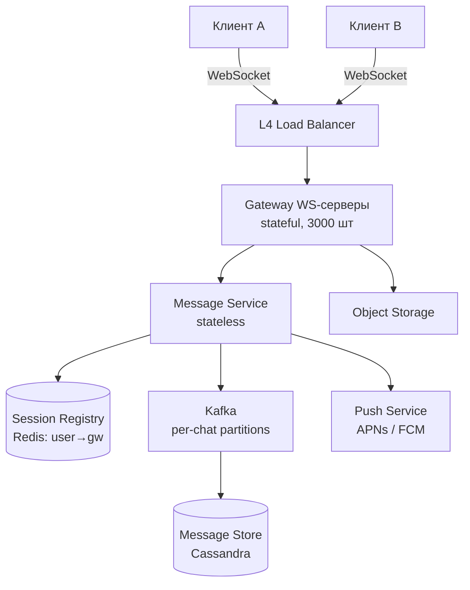

# Проектирование мессенджера (аналог Telegram)

**Задача:** спроектировать систему обмена сообщениями 1:1 и в группах, с историей, доставкой в реальном времени и работой на слабой сети.

---

## 1. Требования

### Функциональные
- Личные чаты (1:1) и группы до 200 000 участников
- Отправка текста, медиа (фото, видео, файлы до 2 ГБ)
- История сообщений — бесконечная, синхронизируется между устройствами
- Статусы прочтения, «печатает…», онлайн-присутствие
- Push-уведомления при офлайне

**За рамками:** звонки, секретные чаты с E2E, боты, каналы, стикеры.

### Нефункциональные
- **Масштаб:** 1 млрд пользователей, 500 млн DAU, 100 млрд сообщений/день
- **Нагрузка:** 100 млрд / 86 400 ≈ **1.15 млн сообщений/сек** (пик 3–5 млн)
- **Latency:** доставка < 500 мс между пользователями в одном регионе
- **Доступность:** 99.99% — мессенджер, который лежит, бесполезен
- **Консистентность:** порядок сообщений в чате строгий (per-chat ordering), глобальный порядок не нужен
- **Durability:** потеря сообщения недопустима после подтверждения отправителю

---

## 2. Оценка нагрузки

### Хранилище
- Среднее сообщение: 100 байт текста + 200 байт метаданных = **300 байт**
- 100 млрд/день × 300 байт = **30 ТБ/день**
- За год: **~11 ПБ** (медиа отдельно — в S3)
- Медиа: ~5% сообщений с медиа, средний размер 500 КБ → 5 млрд × 500 КБ = **2.5 ПБ/день**

### Соединения
- 500 млн DAU × 30% одновременно онлайн = **150 млн WebSocket-соединений**
- Одно соединение: ~10 КБ памяти сокета + буферы
- 150 млн / 50k соединений на сервер = **3 000 серверов только для соединений**

### Трафик
- 1.15 млн сообщений/сек × 300 байт × 2 (отправитель + получатель) ≈ **700 МБ/с** только текст
- С медиа — десятки ГБ/с, но медиа идёт через CDN

---

## 3. Ключевое решение: транспорт

Сообщения должны приходить **сами**, а не по запросу клиента.

| Вариант | Как | Плюсы | Минусы |
|---|---|---|---|
| **Long polling** | Клиент держит HTTP-запрос открытым | Работает везде, простой | Держит соединение, лишние handshake, задержка |
| **SSE** | Сервер пушит по одному HTTP | Простой, автопереподключение | Только server→client, нужен отдельный канал на отправку |
| **WebSocket** | Двусторонний TCP-канал | Минимальная latency, один канал на всё | Stateful, сложный балансинг и деплой |

**Выбор: WebSocket** как основной канал, с fallback на long polling для сетей, где WS блокируется (корпоративные прокси).

**Ключевая проблема WS — состояние.** Соединение привязано к конкретному серверу. Значит:
1. Нужен **sticky routing** или реестр «user_id → server_id» в Redis
2. При деплое сервер умирает → 50k клиентов переподключаются лавиной → нужен **reconnect backoff с джиттером**
3. Серверы stateful → автоскейлинг сложнее, нельзя просто убить инстанс

---

## 4. Архитектура



### Поток отправки сообщения

1. Клиент A → WS → Gateway A: `{chat_id, text, client_msg_id}`
2. Gateway A → Message Service: валидация, проверка прав на чат
3. Message Service присваивает `msg_id` и `seq` (порядковый номер в чате)
4. Запись в Cassandra: `INSERT INTO messages (chat_id, seq, msg_id, sender, text, ts)`
5. Публикация в Kafka, партиция = `chat_id` (**гарантирует порядок внутри чата**)
6. Consumer:
   - Смотрит в Session Registry, где сейчас получатели
   - Отправляет на их Gateway-серверы → те пушат в WS
   - Если получатель офлайн → Push Service → APNs/FCM
7. Gateway A → клиенту A: `ack` с `msg_id` и `seq`

**`client_msg_id`** — клиент генерирует UUID до отправки. Если ack не пришёл и клиент ретраит, сервер по `client_msg_id` понимает, что это дубль (идемпотентность).

---

## 5. Детали компонентов

### 5.1 Хранилище сообщений — Cassandra

**Почему не PostgreSQL:** 1.15 млн writes/sec и 11 ПБ/год — реляционная БД тут требует агрессивного шардирования, а JOIN'ы и ACID не нужны. Нужен только «дай последние N сообщений чата» и «дай сообщения до seq X».

```cql
CREATE TABLE messages (
    chat_id     UUID,
    seq         BIGINT,        -- монотонный номер внутри чата
    msg_id      UUID,
    sender_id   UUID,
    content     TEXT,
    media_ref   TEXT,
    created_at  TIMESTAMP,
    PRIMARY KEY (chat_id, seq)
) WITH CLUSTERING ORDER BY (seq DESC)
  AND compaction = {'class': 'TimeWindowCompactionStrategy',
                    'compaction_window_size': '1',
                    'compaction_window_unit': 'DAYS'};
```

- **Партиция = chat_id** → все сообщения чата на одной ноде → чтение истории одним запросом без scatter-gather
- **Кластеризация по seq DESC** → «последние 50» = `LIMIT 50` без сортировки
- **TWCS** → старые окна компактятся целиком, не переписываются

**Риск: горячая партиция.** Группа на 200k участников с активным флудом даёт тысячи сообщений/сек в одну партицию. Решение — **бакетирование**: партиция `(chat_id, bucket)` где `bucket = seq / 10_000`. Чтение истории идёт по бакетам от новых к старым.

**Где брать `seq`:** счётчик на чат. Варианты — Redis `INCR chat:{id}:seq` (быстро, но можно потерять при отказе) или таблица `chat_sequences` в Cassandra с LWT (`IF seq = expected`). На практике: Redis INCR + периодический checkpoint в Cassandra, при отказе — восстановление с пропуском (пропуски в seq допустимы, порядок сохраняется).

### 5.2 Session Registry — где пользователь онлайн

```
Redis:  user:{user_id} → [gw_id_1, gw_id_2, ...]
        ttl 60 сек, gateway продлевает heartbeat каждые 20 сек
```

Несколько записей — потому что у пользователя может быть несколько устройств (телефон + десктоп) и все должны получить сообщение.

### 5.3 Медиа — presigned URL + CDN

1. Клиент → API: `POST /media/upload-init` → presigned URL в S3
2. Клиент грузит файл напрямую в S3 (multipart для больших)
3. Клиент отправляет сообщение с `media_ref = s3://...`
4. При отдаче получателю — URL проксируется через CDN с подписью

**Почему не через WebSocket:** 2 ГБ файл через WS-канал заблокирует его на минуты, сломает heartbeat и съест память сервера.

### 5.4 Push при офлайне

Если в Session Registry нет живых gateway:
- Push Service → APNs (iOS) / FCM (Android)
- Push содержит только «у тебя новое сообщение в чате X», **не текст** — экономия и приватность
- При открытии приложения клиент догружает пропущенное: `GET /chats/{id}/messages?after_seq={last_seen}`

**Батчинг пушей:** если пользователь офлайн и ему написали 50 сообщений — не 50 пушей, а один «50 новых сообщений». Иначе Apple/Google зарежут по rate limit.

### 5.5 Синхронизация между устройствами

Каждое устройство хранит `last_seq` для каждого чата. При подключении:
```
GET /sync?cursor={global_cursor} → дельта всех чатов с новыми сообщениями
```
`global_cursor` — глобальная позиция (например, `(timestamp, chat_id)`), чтобы не запрашивать каждый чат отдельно.

---

## 6. Порядок сообщений — главная тонкость

**Требование:** все участники видят сообщения в одном порядке. Иначе разговор превращается в кашу.

**Как обеспечить:**
1. `seq` присваивается **единственным владельцем чата** — Message Service, шардированный по `chat_id` (consistent hashing). Все сообщения одного чата идут через один инстанс (или через Kafka-партицию по `chat_id`).
2. Kafka-партиция по `chat_id` → consumer обрабатывает чат последовательно.
3. Клиент сортирует по `seq`, а не по локальному времени (часы у устройств расходятся на минуты).

**Что НЕ нужно:** глобальный порядок между чатами. Сообщение в чате A и чате B могут иметь любые относительные `seq` — это разные пространства.

---

## 7. Узкие места

### 7.1 Thundering herd при реконнекте
Сервер упал → 50k клиентов одновременно переподключаются → перегрузка LB и Gateway.
- **Backoff с джиттером:** `delay = min(cap, base * 2^attempt) * random(0.5, 1.5)`
- **Jitter критичен:** без него все клиенты синхронно бьют в одну секунду

### 7.2 Групповой чат на 200k участников
Одно сообщение → 200k доставок.
- Нельзя fan-out в БД (200k записей на сообщение)
- Доставка идёт через Session Registry: смотрим, кто онлайн, пушим только им; офлайн получают при следующем `sync`
- Онлайн из 200k обычно 1–5% = 2–10k доставок — терпимо

### 7.3 Медиа-бомба
Пользователь шлёт 100 фото подряд в группу → 100 × 200k = 20 млн доставок.
- Rate limit на отправку (например, 20 сообщений/мин в группу)
- Дедупликация по хешу файла (одинаковое фото в 10 чатах → один объект в S3)

### 7.4 Хранение истории «навсегда»
11 ПБ/год растёт линейно.
- Тiered storage: горячие 3 месяца в Cassandra на SSD, дальше — в S3 + холодное чтение
- Или TTL по умолчанию для медиа (Telegram хранит, но это дорогое продуктовое решение)

---

## 8. Что не вошло, но обсуждается на интервью

- **E2E-шифрование:** ключи только у клиентов, сервер не может искать по тексту, push без текста, backup ключей — отдельная большая тема
- **Мультирегион:** пользователи в разных регионах → репликация чата между ДЦ, конфликты seq решаются «домашним» регионом чата
- **Поиск по сообщениям:** Elasticsearch с асинхронной индексацией из Kafka
- **Удаление сообщений:** tombstones в Cassandra, «удалено у всех» = запись-заглушка вместо текста

---

## 9. Итог

| Компонент | Решение | Почему |
|---|---|---|
| Транспорт | WebSocket + long polling fallback | Минимальная latency, работает в слабых сетях |
| Gateway | Stateful, 3000 инстансов | Держат соединения, реестр в Redis |
| Сообщения | Cassandra, партиция `chat_id` | 1.15 млн writes/sec, чтение истории без scatter-gather |
| Порядок | `seq` на чат + Kafka-партиция по чату | Единственный источник истины для порядка |
| Онлайн | Redis Session Registry, TTL 60 сек | Знаем, куда доставлять |
| Медиа | S3 + CDN, presigned URL | WS не для гигабайтов |
| Офлайн | APNs/FCM, батчинг | Не 50 пушей, а один |
| Идемпотентность | `client_msg_id` | Ретраи не создают дублей |

**Главная мысль для интервью:** мессенджер — это не про хранение, а про **доставку в реальном времени**. 80% сложности в stateful-соединениях, реестре присутствия и порядке сообщений. Хранилище (Cassandra) — самая простая часть.
