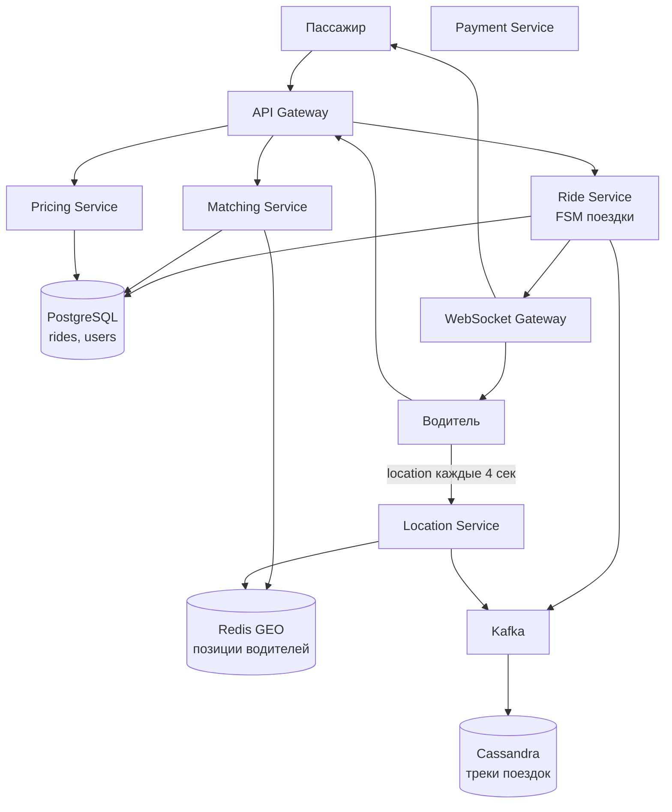

# Проектирование сервиса такси (аналог Uber)

**Задача:** спроектировать систему, которая сводит пассажира с ближайшим водителем, ведёт поездку в реальном времени и считает цену.

---

## 1. Требования

### Функциональные
- Пассажир указывает точку А и Б, видит цену и оценку времени подачи
- Система находит ближайших свободных водителей и предлагает заказ
- Водитель принимает/отклоняет
- Отслеживание машины на карте в реальном времени
- Расчёт финальной стоимости, оплата, чек
- История поездок, рейтинги

**За рамками:** карпулинг, доставка еды, водительские бонусы, антифрод.

### Нефункциональные
- **Масштаб:** 10 млн водителей, 100 млн пассажиров, 20 млн поездок/день
- **Нагрузка:**
  - 20 млн поездок / 86 400 ≈ **230 заказов/сек** (пик 2 000)
  - **Обновления локации:** 10 млн водителей × 1 раз/4 сек = **2.5 млн writes/сек** — это главная нагрузка
  - Чтение карты: 100 млн активных × 1/10 сек = 10 млн reads/сек
- **Latency:** матчинг < 5 сек, обновление позиции на карте < 2 сек
- **Доступность:** 99.99% — без сервиса водители не работают
- **Консистентность:** **критично — один водитель = один заказ**. Двойное назначение ломает продукт

---

## 2. Ключевое решение: геопространственный индекс

Задача «найди ближайших водителей» на 10 млн точек.

| Подход | Как | Проблема |
|---|---|---|
| SQL `ORDER BY distance` | Полный скан таблицы водителей | 10 млн строк на каждый запрос — смерть |
| PostGIS + GiST-индекс | Индекс по геометрии, `ST_DWithin` | Один PostGIS не держит 2.5 млн writes/сек |
| **Геохеш / S2 / H3** | Мир разбит на ячейки, водитель → ячейка | Нужна логика соседних ячеек и «горячих» ячеек — но масштабируется |

**Выбор: геопространственное индексирование через ячейки + in-memory хранилище.**

**H3 (Uber)** — гексагональная сетка. Ключевое свойство: у ячейки H3 ровно 6 соседей (у квадратов — 8, и расстояния до них разные). Разрешение res=7 — ячейка ~5 км². 

**Геохеш** — альтернатива (прямоугольники, вложенность через префикс строки), проще и есть в Redis (`GEOADD`/`GEOSEARCH`), но у полюсов и на границах ячеек работает хуже.

**Хранение позиций:** Redis, не БД.
```
GEOADD drivers:active {lng} {lat} {driver_id}     // или ключ на H3-ячейку
GEOSEARCH drivers:active FROMLONLAT {lng} {lat} BYRADIUS 2 km ASC
```
Redis держит 2.5 млн writes/сек в кластере из ~20 нод. Всё в памяти — 10 млн точек × ~100 байт = 1 ГБ, влезает.

---

## 3. Архитектура



### Поток заказа

1. Пассажир → RS: `POST /rides {from, to, class}` 
2. RS → PS: расчёт цены и ETA → возвращает оффер пассажиру
3. Пассажир подтверждает → RS создаёт `ride` в статусе `searching`
4. RS → MS: `find_driver(ride_id, location, radius)`
5. MS: `GEOSEARCH` → список кандидатов, отсортированных по расстоянию
6. MS **последовательно** предлагает заказ: водителю 1 → ждёт 10 сек → водителю 2 …
7. Водитель принял → **атомарная проверка**: `SET driver:{id}:status busy NX` в Redis. Если не получилось — водитель уже занят, берём следующего
8. RS: `ride.status = accepted`, назначает водителя, шлёт данные пассажиру и водителю через WS
9. Поездка: водитель шлёт локацию каждые 4 сек → LS → Redis + Kafka → трек в Cassandra
10. Завершение → расчёт финальной цены → Payment Service → чек

---

## 4. Детали компонентов

### 4.1 Location Service — 2.5 млн writes/сек

**Что делает:** принимает `{driver_id, lat, lng, heading, speed, ts}` каждые 4 секунды от каждого активного водителя.

**Почему не в БД:** 2.5 млн writes/сек в PostgreSQL невозможны без огромного парка. Redis с `GEOADD` — O(log N), просто обновляет позицию в памяти.

**Важные оптимизации:**
- **Батчинг:** водитель шлёт раз в 4 сек вместо 1 сек (при скорости 60 км/ч это 67 метров — достаточно)
- **Только активные:** водитель, у которого закрыто приложение или он офлайн, вообще не шлёт. `drivers:active` — только те, кто сейчас на смене
- **Дедупликация:** одно обновление на водителя, старая позиция перезаписывается (не история)
- **История** (для трека поездки, для споров) — Kafka → Cassandra, партиция `(driver_id, date)`; нужно только для активной/недавней поездки

### 4.2 Matching Service — самое тонкое место

**Проблема жадного матчинга:** «ближайший водитель» — не оптимально глобально. Два заказа рядом, один водитель — если матчить жадно по одному, второй заказ получит дальнего водителя.

**Реальные подходы:**
- **Greedy + sequential offer** (проще, используется большинством) — предлагаем по одному, ждём 10–15 сек, отказ → следующий. Плохо при дефиците водителей.
- **Batch matching** (Uber/Lyft делают так) — накапливаем заказы за окно 2–5 сек, решаем задачу о назначениях (Hungarian algorithm / min-cost flow) на этом батче. Глобально оптимально, но добавляет задержку. Оправдано в час пик.
- **Аукцион** — водитель видит несколько заказов и выбирает. Хорошо для рынка с перевесом водителей.

**Критическое свойство: один водитель = один заказ.**
```
SET driver:{id}:status busy NX EX 3600
```
`NX` — атомарно «поставь, только если не busy». Даже если два матчера одновременно выбрали одного водителя, второй получит `false`.

Дополнительно: водитель может «принять» два оффера от двух разных инстансов (сеть, ретраи). Защита — та же атомарная операция + идемпотентность по `offer_id`.

### 4.3 Ride Service — конечный автомат

Поездка — это FSM, и её состояние должно быть строгим:

```
requested → searching → driver_assigned → driver_arriving
→ in_progress → completed
                     ↘ cancelled
```

Каждый переход — транзакция в PostgreSQL с проверкой текущего состояния (`UPDATE rides SET status='in_progress' WHERE id=? AND status='driver_arriving'`). 0 строк обновлено → недопустимый переход.

**Почему PostgreSQL:** поездки — это деньги и юридические документы. Нужны ACID, отчёты, сложные запросы (поездки водителя за период, для налогов). Объём: 20 млн/день × 500 байт = 10 ГБ/день — PostgreSQL с шардированием по `city_id` держит.

### 4.4 Pricing Service

**Базовая цена:** `base + distance × rate + time × rate`.

**Surge pricing (повышающий коэффициент):**
- Считается по **ячейке**: `demand(ячейка) / supply(ячейка)` за последние 5 минут
- Пример: 50 заказов и 10 водителей в ячейке → коэффициент 2.5×
- **Ключевой нюанс:** коэффициент должен быть **стабильным**, иначе пассажир видит 1.5×, нажимает «заказать» и видит 2.3× — это воспринимается как обман
- Решение: коэффициент фиксируется на 5 минут, показывается с явным «цена может измениться», и на короткий период (2 мин) гарантируется

**Проблема скачков:** шаг сетки и сглаживание (EMA) по времени и по соседним ячейкам, иначе на границе ячеек цена отличается вдвое.

### 4.5 Отслеживание в реальном времени

- Водитель → WS/HTTP: локация каждые 4 сек
- Location Service → Redis (актуальная позиция) + Kafka (поток)
- Kafka → WebSocket Gateway → пассажир видит машину
- **Проблема:** 10 млн подписчиков на карту → нельзя пушить всем всё. Пассажир подписан **только на свою поездку** (1 водитель), остальные машины на карте — редкий polling раз в 10–30 сек через отдельный эндпоинт «машины в области»

### 4.6 Оффлайн и потеря связи

Водитель в тоннеле, связь пропала.
- WS-соединение рвётся → водитель помечается «неизвестно где», но **не свободен** (он в поездке)
- Пассажир видит «последняя известная позиция»
- При восстановлении: водитель шлёт батч накопившихся точек → трек досинхронизируется
- Если поездка не завершилась за N часов → автоматическое закрытие по расчётной цене + ручная проверка

---

## 5. Узкие места

### 5.1 Пик спроса (пятница, вечер, дождь)
Заказов в 10× больше обычного, водителей столько же.
- Surge поднимает цену → часть спроса отваливается, часть водителей выходит на смену
- Matching переходит в batch-режим (глобальная оптимизация важнее скорости)
- Очередь заказов: пассажир видит «ищем машину, ~7 минут», заказ не теряется

### 5.2 Горячие ячейки
Аэропорт, стадион — тысячи водителей в одной ячейке.
- Одна ячейка = один ключ Redis = горячий шард
- Решение: **более мелкие ячейки** (res=8/9) для плотных зон, или шардирование ключа по `driver_id`
- `GEOSEARCH` по мелким ячейкам + сбор соседей в приложении

### 5.3 Локация как поток данных
2.5 млн writes/сек × 86 400 = 216 млрд точек в день. Писать всё в БД безумно.
- В БД — **только точки активной поездки** (сэмплирование до 1 точки / 10 сек)
- Всё остальное — в Kafka → ClickHouse / S3 для аналитики и ML (ETA-модели)
- TTL на Redis: `drivers:active` живёт только пока водитель онлайн

### 5.4 Двойное назначение и «фантомные» водители
Водитель принял заказ, но у него уже едет пассажир (баг клиента или злой умысел).
- Атомарный статус в Redis (см. 4.2)
- **Дополнительная проверка в БД:** водитель не может иметь два `ride` в статусе `driver_assigned`/`in_progress` — partial unique index: `UNIQUE (driver_id) WHERE status IN ('driver_assigned','in_progress')`
- Это последняя линия обороны: даже если Redis дал сбой, БД не пропустит

---

## 6. Итог

| Компонент | Решение | Почему |
|---|---|---|
| Позиции водителей | Redis GEO (H3-ячейки при плотности) | 2.5 млн writes/сек — только in-memory |
| Матчинг | Greedy offer + атомарный `SETNX`; batch в пик | Просто и надёжно, глобальная оптимизация когда нужно |
| Поездки | PostgreSQL, FSM + partial unique index | Деньги и документы: ACID обязателен |
| Треки | Kafka → Cassandra / ClickHouse | 216 млрд точек/день, только для аналитики |
| Реалтайм | WebSocket, подписка только на свою поездку | 10 млн подписчиков не пушатся все |
| Цена | Базовая + surge с фиксацией на 5 мин | Предсказуемость важнее точности |

**Главная мысль для интервью:** в такси два независимых потока с разной природой — **поток локаций** (гигантский, эфемерный, in-memory) и **поток поездок** (небольшой, но требует ACID). Их нельзя складывать в одну БД. И самое частое, что проверяют — как вы гарантируете «один водитель = один заказ» (атомарность + unique index в БД как страховка).
