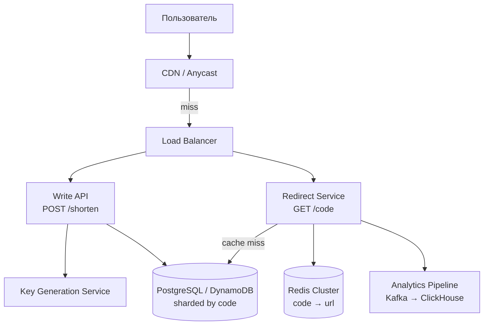

# Проектирование сервиса коротких ссылок (аналог Bit.ly)

**Задача:** из длинного URL сделать короткий, при переходе — редирект на исходный, плюс статистика кликов.

---

## 1. Требования

### Функциональные
- `POST /shorten {long_url} → {short_url}`
- `GET /{code} → 301/302 на long_url`
- Кастомные алиасы (`bit.ly/my-brand`)
- Срок жизни ссылки (опционально)
- Статистика: клики, гео, referrer, устройство

**За рамками:** QR-коды, A/B-роутинг ссылок, защита паролем.

### Нефункциональные
- **Масштаб:** 100 млн новых ссылок/день, **100 млрд редиректов/день**
- **Нагрузка:** 100 млн / 86 400 ≈ **1 200 созданий/сек**; 100 млрд / 86 400 ≈ **1.16 млн редиректов/сек** (пик 5 млн)
- **Соотношение чтение:запись ≈ 1000:1** — это главное, что определяет архитектуру
- **Latency редиректа:** < 20 мс (P99) — редирект стоит на пути у пользователя
- **Доступность:** 99.99% — сломанные ссылки ломают весь интернет
- **Durability:** ссылка должна работать годами, удаление = 404 у тысяч людей

---

## 2. Оценка нагрузки

| Метрика | Расчёт |
|---|---|
| Новых ссылок/день | 100 млн |
| За 5 лет | 100 млн × 365 × 5 = **182 млрд записей** |
| Размер записи | code (7 байт) + url (100 байт) + метаданные (50 байт) ≈ **200 байт** |
| Хранилище | 182 млрд × 200 байт ≈ **36 ТБ** |
| Редиректов/сек | **1.16 млн** (пик 5 млн) |
| Кэш | 20% ссылок дают 80% трафика → горячий набор ~1 ТБ → влезает в RAM кластера |

**Вывод:** хранилище маленькое (36 ТБ), но QPS огромный. Значит — **кэш на первом месте**, БД вторична.

---

## 3. Генерация короткого кода

Это главный вопрос задачи. Варианты:

### 3.1 Base62 от автоинкремента
`id = 182_000_000_000` → base62 → `"aB3xK9z"` (7 символов дают 62⁷ ≈ 3.5 трлн комбинаций).

- ✓ Короткий код, нет коллизий by design
- ✓ Предсказуемая длина
- ✗ **Последовательные коды** → можно перебрать чужие ссылки (`aB3xK9z`, `aB3xK9y`, …) → утечка приватных URL
- ✗ Автоинкремент = единая точка (нужен распределённый счётчик)

**Фикс перебора:** добавить соль/перестановку — `code = base62(permute(id))`, где `permute` — обратимая биекция (например, умножение по модулю простого числа). Код остаётся уникальным, но перестаёт быть последовательным.

### 3.2 Хеш от URL (MD5/SHA → base62, первые 7 символов)
- ✓ Одинаковые URL → одинаковый код (дедупликация)
- ✗ **Коллизии** — при 182 млрд ссылок и 7 символах birthday paradox даёт много коллизий → нужна проверка + retry
- ✗ Нельзя сделать кастомный алиас

### 3.3 Случайный код + проверка на коллизию
- ✓ Непредсказуем
- ✗ На больших объёмах — 2 запроса (проверить + вставить), гонки
- ✗ При заполнении пространства кодов растёт число retry

### 3.4 Выбор: распределённый счётчик + перемешивание (KGS)

**Key Generation Service** — отдельный сервис, который заранее генерирует коды пачками и раздаёт их инстансам API.

- KGS держит в памяти пул «свободных» кодов (например, 1 млн штук)
- API-инстанс при создании ссылки берёт код из своего локального пула (без сети)
- Пул кончился → запрос новой пачки у KGS (1 запрос на 10 000 ссылок)
- KGS помечает выданные коды как «использованные» в БД. Если инстанс упал с неиспользованными кодами — они просто потеряны (пропуск в нумерации не проблема)

- ✓ Нет коллизий (коды не повторяются)
- ✓ Нет сетевого запроса на каждое создание
- ✓ Непредсказуемость через перемешивание
- ✗ Дополнительный сервис (но он простой и почти не падает)

**Длина кода:** 7 символов base62 = 3.5 трлн. При 182 млрд за 5 лет — заполнение 5%. Хватает на десятилетия. 8 символов — если планируется больше.

---

## 4. Архитектура



### Поток создания
1. `POST /shorten {long_url, custom_alias?}`
2. Валидация: URL корректен, длина < 2000, не в blocklist
3. Если `custom_alias` → проверка занятости (atomic insert, `ON CONFLICT DO NOTHING`)
4. Иначе → код из локального пула KGS
5. `INSERT INTO links (code, long_url, created_at, expires_at, owner_id)`
6. Ответ `{short_url: "https://sh.rt/aB3xK9z"}`
7. Прогрев кэша: `SET code → long_url` (необязательно, но первая сотня кликов будет быстрой)

### Поток редиректа (критичный путь)
1. `GET /aB3xK9z`
2. **Redis**: `GET code:aB3xK9z` → hit за ~0.5 мс
3. Miss → БД → `SET` с TTL 24 ч → ответ
4. Отправить событие клика в Kafka (**асинхронно, не блокируя редирект**)
5. `302 Found` + `Location: long_url`

---

## 5. Критические детали

### 5.1 301 vs 302

| Код | Поведение | Когда |
|---|---|---|
| **301 Moved Permanently** | Браузер кэширует навсегда, дальше ходит напрямую | Экономит трафик, но **вы теряете статистику** и не можете изменить цель |
| **302 Found** | Браузер не кэширует, каждый раз идёт к вам | Статистика полная, можно менять цель, но каждый клик — запрос к вам |

**Ответ для Bit.ly-подобного сервиса:** **302**. Продукт живёт статистикой. Если бы это был внутренний сервис без аналитики — 301.

Исключение: если ссылка помечена как «вечная» и владелец отказался от аналитики — 301.

### 5.2 Аналитика не должна тормозить редирект

Клик → записать в БД синхронно = +5 мс к P99 и 1.16 млн writes/сек в БД.

**Решение:** редирект возвращается сразу, событие летит в Kafka (fire-and-forget). Дальше:
- Kafka → агрегатор (окно 1 мин) → ClickHouse
- ClickHouse держит 100k+ вставок/сек и даёт аналитику по срезам

**Защита от потери:** буфер в памяти процесса + батчинг по 1000 событий или 200 мс. При переполнении буфера — дропаем (потерять 0.01% кликов приемлемо, замедлить редирект — нет).

### 5.3 Кэш — главный компонент

- Redis Cluster, шардирование по `code`
- **Что кэшировать:** только активные ссылки. LRU-эвикция.
- **Hit rate:** при правильном размере — 95%+
- **TTL 24 ч** — защита от «призраков» (удалённая ссылка живёт в кэше до суток). Для «удалено навсегда» — explicit `DEL`.
- **Отрицательный кэш:** несуществующий код тоже кэшируем (`404`, TTL 1 мин) — иначе боты со словарём кодов положат БД

**Что делать при отказе Redis:** БД получает 1.16 млн QPS — умрёт. Защита:
- Circuit breaker + rate limit на уровне API (пропускаем N запросов/сек к БД)
- Read replicas
- Degraded mode: отдаём 503 на часть запросов вместо обрушения всего

### 5.4 Шардирование БД

Ключ шарда — `code` (hash от кода). Почему не `owner_id`: редирект не знает владельца, нужен прямой lookup по `code`.

**Проблема шардирования по `code`:** запрос «все ссылки пользователя» идёт по всем шардам (scatter-gather).

**Решение:** две таблицы/индекса:
- `links_by_code` — шард по `code` (для редиректов, 99.9% запросов)
- `links_by_owner` — шард по `owner_id` (для дашборда пользователя)

Дублирование данных оправдано разницей в нагрузке.

### 5.5 Кастомные алиасы и гонки

Два пользователя одновременно просят `bit.ly/promo`:
```sql
INSERT INTO links (code, long_url, owner_id) VALUES ('promo', ..., ...)
ON CONFLICT (code) DO NOTHING RETURNING code;
```
Пустой результат → алиас занят → 409. Никаких «проверить, потом вставить».

### 5.6 Срок жизни и очистка

- `expires_at` в записи
- Lazy-проверка при редиректе: `expires_at < now()` → 410 Gone
- Фоновая джоба раз в сутки удаляет просроченные (батчами по 10k)
- **Не** использовать TTL БД как единственный механизм — нужен явный 410, а не 404

---

## 6. Узкие места

### 6.1 Всплеск на одну ссылку
Ссылка в рекламе на ТВ → 100k RPS на один код.
- Redis: один ключ — один шард → **горячий ключ**
- Решение: локальный in-process кэш (Caffeine/LRU, TTL 10 сек) на каждом API-инстансе. 100 инстансов × 10k RPS из памяти = Redis почти не нагружен.
- Плюс: `long_url` для редиректа **неизменяем**, так что кэшировать безопасно

### 6.2 Боты и словарные атаки
Сканер перебирает `/aaaaaaa`…`/zzzzzzz`.
- Отрицательный кэш (см. 5.3)
- Rate limit по IP (token bucket, 100 req/мин)
- WAF-правила на паттерн последовательных кодов

### 6.3 Спам и вредоносные ссылки
Сервис обязан не выдавать редирект на фишинг.
- Проверка `long_url` по Google Safe Browsing при создании (асинхронно, ссылка сначала `pending`)
- Периодическая перепроверка активных ссылок
- Blocklist доменов
- **Важно:** проверка не должна задерживать редирект — она либо на этапе создания, либо на этапе фоновой проверки с последующей блокировкой

### 6.4 Мультирегион
1.16 млн RPS по миру — один регион даёт +150 мс latency для удалённых пользователей.
- **Anycast** на уровне DNS: пользователь попадает в ближайший регион
- Каждый регион имеет свой Redis и read-replica БД
- Запись — в домашний регион, репликация в остальные (задержка 1–2 сек; ссылка, созданная только что, может не работать в другом регионе 1–2 сек — приемлемо)

---

## 7. Итог

| Компонент | Решение | Почему |
|---|---|---|
| Генерация кода | KGS: пул base62 + перемешивание | Нет коллизий, нет перебора, нет сети на каждое создание |
| Хранилище | Шард по `code`, 36 ТБ | Маленькие данные, но прямой lookup |
| Редирект | 302 + Redis (95% hit) | Продукт живёт статистикой |
| Аналитика | Kafka → ClickHouse, fire-and-forget | Нельзя тормозить редирект ради метрик |
| Кэш | Redis + in-process LRU | Защита от горячих ключей и отказа Redis |
| Гонки алиасов | `ON CONFLICT DO NOTHING` | Атомарность на уровне БД |

**Главная мысль для интервью:** задача выглядит тривиальной, но проверяет три вещи — (1) понимание read:write 1000:1 и роли кэша, (2) генерация ID без коллизий и без перебора, (3) понимание, что 301 убивает продукт. Плюс асинхронная аналитика — классический вопрос «как не замедлить горячий путь».
