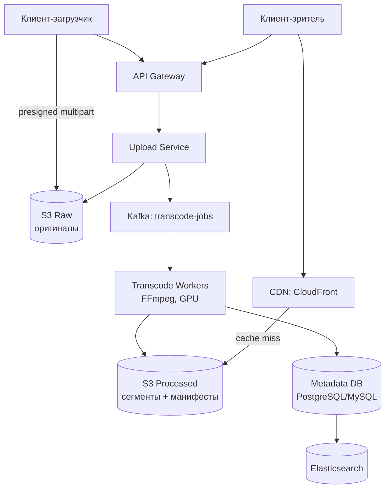

# Проектирование видеохостинга (аналог YouTube)

**Задача:** спроектировать сервис загрузки, обработки и просмотра видео.

---

## 1. Требования

### Функциональные
- Загрузка видео любого размера (до 256 ГБ, до 12 часов)
- Транскодирование в несколько разрешений и кодеков
- Просмотр с адаптивным качеством под скорость сети
- Поиск по названию, описанию, каналу
- Просмотры, лайки, комментарии (упрощённо)

**За рамками:** рекомендации, монетизация, живые трансляции, модерация контента.

### Нефункциональные
- **Масштаб:** 2 млрд пользователей, 1 млрд часов просмотра/день
- **Загрузка:** 500 часов видео загружается каждую минуту
- **Просмотр:** 1 млрд часов/день ≈ **11.5 млн часов/час** ≈ одновременный стриминг ~10 Тбит/с
- **Latency:** старт воспроизведения < 1 сек, буферизация < 0.5% времени
- **Доступность:** 99.9% (просмотр), 99.5% (загрузка)
- **Консистентность:** eventual — новое видео появляется в поиске через минуты, это нормально

---

## 2. Оценка нагрузки

### Хранилище
- 500 часов/мин × 60 × 24 = **720 000 часов видео/день**
- Средний битрейт оригинала 5 Мбит/с → 720k × 3600 × 5/8 ≈ **1.6 ПБ/день оригиналов**
- После транскодирования в 5 качеств (240p–4K) — ×3 к оригиналу ≈ **5 ПБ/день**
- За год: **~1.8 ЭБ** (эксабайт). Это реальный порядок YouTube.

### Трафик просмотра
- 1 млрд часов/день = 3600 млрд секунд
- Средний битрейт отдачи 2 Мбит/с → **~900 ПБ/день ≈ 83 Тбит/с**
- **Без CDN это невозможно физически.** 99%+ трафика идёт через CDN.

---

## 3. Ключевое решение: разбиение на сегменты

**Нельзя отдавать видео одним файлом.** Причины:
- Нельзя переключить качество на ходу
- Нельзя начать просмотр, пока не скачан весь файл
- Один файл на 1 ГБ нельзя эффективно кэшировать (все смотрят с разных мест)

**Решение: HLS/DASH**
1. Видео транскодируется в N качеств
2. Каждое качество нарезается на **сегменты по 2–6 секунд** (обычно 4 сек)
3. Генерируется **манифест** (`.m3u8` для HLS) — список сегментов с битрейтами
4. Плеер скачивает манифест, затем сегменты по одному, переключая качество при изменении скорости сети

**Почему это работает для кэша:** популярный видео-сегмент (`video123/720p/seg0042.ts`) — это маленький статичный файл. CDN кэширует его навсегда, hit rate взлетает до 95%+.

```
GET /videos/v123/master.m3u8       → список качеств
GET /videos/v123/720p/index.m3u8   → сегменты 720p
GET /videos/v123/720p/seg0042.ts   → 4 секунды видео, ~1 МБ
```

---

## 4. Архитектура



### Поток загрузки

1. Клиент → API: `POST /videos/init` → `{video_id, presigned_urls[20]}`
2. Клиент грузит файл частями напрямую в S3 (multipart, параллельно)
3. Клиент → API: `POST /videos/{id}/complete` → статус `uploaded`
4. API → Kafka: `TranscodeJob{video_id, s3_key}`
5. Transcode Worker:
   - Скачивает оригинал из S3
   - FFmpeg → 5 качеств (240p, 480p, 720p, 1080p, 4K)
   - Нарезка на 4-секундные сегменты
   - Загрузка сегментов + манифестов в S3
   - Превью (thumbnail) — 5 кадров на разных таймкодах
6. Обновление статуса в БД: `processing` → `ready`
7. Индексация в Elasticsearch
8. Клиент видит видео в списке через polling статуса или WebSocket-нотификацию

**Время обработки:** 10-минутное видео → ~5–10 минут транскодирования на CPU, ~1–2 минуты на GPU. Отсюда — очередь и приоритезация (короткие видео обрабатываются первыми).

---

## 5. Детали компонентов

### 5.1 Хранилище — S3

Двухуровневая структура:
- **Raw:** `s3://raw/{video_id}/original.mp4` — хранится вечно (нужен для перекодирования при новых кодеках)
- **Processed:** `s3://processed/{video_id}/{quality}/seg{n}.ts` + манифесты

**Классы хранения:** только что загруженное — Standard. Видео без просмотров 90 дней — Infrequent Access. Более года — Glacier. Это снижает стоимость в 5–10 раз.

**Проблема `S3 PUT rate`:** 5 500 PUT/sec на префикс. При тысячах одновременных транскодирований — префикс `processed/{video_id}/` уже шардирует по video_id, этого достаточно.

### 5.2 Транскодирование

**Почему это самая дорогая часть:** 720k часов/день × 5 качеств = 3.6 млн часов CPU-работы в день.

Решения:
- **GPU вместо CPU:** NVENC на T4/A10 ускоряет в 5–10×, окупается при больших объёмах
- **Spot instances:** транскодирование прерываемо (можно перезапустить с нуля), spot дешевле в 3×
- **Chunked transcoding:** видео режется на 10-минутные куски и кодируется параллельно, потом склеивается (так делает YouTube)
- **Приоритеты:** видео с большим каналом вперёд, длинный хвост — в фоне, ночью

**Кодеки:** H.264 (совместимость 100%), VP9/AV1 (на 30–50% лучше сжатие, но дороже кодировать). AV1 сейчас — выбор для новых видео при большом канале.

### 5.3 CDN — 99% трафика

- **Pull CDN** — PoP сам подтягивает сегмент при первом запросе
- **Cache-Control:** `public, max-age=31536000, immutable` — сегменты никогда не меняются
- **Манифесты:** TTL короткий (60 сек), чтобы новые качества подхватывались
- **Топ-видео** можно push'ить на PoP заранее, но long tail выигрывает от pull

**Multi-CDN:** при 10 Тбит/с один провайдер физически не покроет мир. YouTube/Netflix используют 2–5 CDN, переключая клиента по latency-пробе.

**Почему CDN дешевле:** трафик из S3 стоит $0.09/ГБ, из CDN — $0.02–0.05/ГБ с commit-контрактом. На петабайтах разница в миллионы долларов.

### 5.4 Адаптивный битрейт — ABR

Плеер решает, какой сегмент качать следующим:
- Измеряет скорость скачивания предыдущего сегмента
- Если буфер пустеет → переключается на качество ниже
- Если буфер полон и сеть быстрая → повышает

Состояние буфера + скорость сети = решение каждые 4 секунды. Это клиентская логика, сервер только отдаёт манифест.

### 5.5 Метаданные и поиск

**PostgreSQL/MySQL:** видео (id, title, description, channel_id, duration, status, view_count). Объём мал — миллиарды строк, но по 1 КБ, шардируется по `video_id`.

**Elasticsearch:** полнотекстовый поиск по названию и описанию. Индексируется асинхронно из Kafka после `ready`. Поиск по транскрипту (автосубтитры от Whisper) — отдельный индекс.

**Счётчик просмотров:** не UPDATE на каждый просмотр (это 10k+ writes/sec на видео). Решение — агрегация в Redis (`INCR view:{video_id}`) + периодический flush в БД раз в минуту. Плюс отдельный поток событий в ClickHouse для аналитики канала.

---

## 6. Узкие места

### 6.1 Старт воспроизведения (time-to-first-frame)
Пользователь нажимает play → должно начаться < 1 сек.
- Манифест маленький (~2 КБ) — кэшируется на edge
- Первый сегмент предзагружается при наведении на превью (prefetch)
- DNS + TLS уже прогреты (preconnect)

### 6.2 Вирусное видео
Видео набрало 100 млн просмотров за час → 10 Тбит/с на один объект.
- CDN кэширует сегменты на всех PoP → origin почти не нагружается
- Но: cache miss на «холодном» PoP в момент пика → origin получает всплеск
- Решение: **push-прогрев** топ-видео на PoP при обнаружении аномального роста (по метрикам)

### 6.3 Удаление видео
Видео удалено → 500 сегментов в S3 + кэш на тысячах PoP.
- S3: удалить объекты (lifecycle или прямой вызов)
- CDN: purge по префиксу `videos/{id}/*` — дорого, но выполнимо
- Reality: часто просто помечают `deleted` в БД, а объекты живут до истечения lifecycle

### 6.4 Стоимость хранения
1.8 ЭБ/год — это десятки миллионов долларов в год только за хранение.
- Реальное YouTube хранит только исходное качество исходника + производные
- Старые/непопулярные видео перекодируются в более эффективные кодеки (экономия 30–50% места)
- Удаление по политике (аккаунты, нарушающие правила)

---

## 7. Итог

| Компонент | Решение | Почему |
|---|---|---|
| Оригиналы | S3 + lifecycle в Glacier | 1.6 ПБ/день, дешёвое холодное хранение |
| Формат | HLS, сегменты 4 сек, 5 качеств | Кэшируемость, ABR, быстрый старт |
| Транскодирование | GPU + spot + chunked | Самая дорогая часть, оптимизируется в первую очередь |
| Доставка | Multi-CDN, 99% трафика | 83 Тбит/с физически невозможно без CDN |
| Метаданные | PostgreSQL (мало данных) + Elasticsearch | Реляционные данные + полнотекстовый поиск |
| Просмотры | Redis INCR + batch flush | Не писать в БД на каждый просмотр |

**Главная мысль для интервью:** YouTube — это **две почти независимые системы**: загрузка (редкая, тяжёлая, асинхронная) и просмотр (массовый, лёгкий, кэшируемый). Их надо проектировать раздельно. 90% сложности и денег — в транскодировании и CDN.
