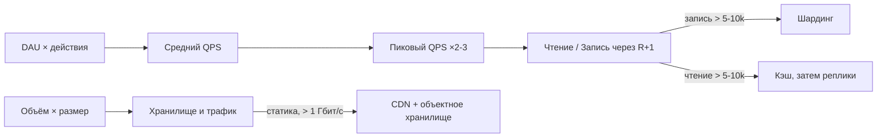

# 01. Оценка нагрузки (back-of-the-envelope)

Дата: 2026-10-31

## Суть

Оценка нагрузки — быстрый расчёт «на салфетке», который показывает масштаб системы до выбора архитектуры. На собеседовании это второй шаг после уточнения требований. Точность нужна до порядка величины: 10, 100 или 10 000 серверов. Важно проговаривать допущения вслух и проверять ответ здравым смыслом.

## Как работает

### Базовые формулы

| Что считаем | Формула |
|---|---|
| Средний QPS | DAU × действий на пользователя в день / 86 400 |
| Пиковый QPS | средний × 2–3 (событийные сервисы ×10 и больше) |
| Запись при R:1 | QPS / (R + 1) |
| Чтение при R:1 | QPS × R / (R + 1) |
| Хранилище | записей в день × размер × дней × репликация |
| Трафик | просмотров в день × размер / 86 400 |
| Одновременные запросы (формула Литтла) | QPS × время ответа в секундах |
| Ёмкость сервера приложения | ядра × 1000 / мс CPU на запрос, загрузка не больше ~60% |

Быстрый счёт: 1 день ≈ 10⁵ секунд, 1 млн запросов в день ≈ 12 QPS.

### Деление QPS на чтение и запись

Соотношение 10:1 — это 11 частей: 10 на чтение и 1 на запись.

- Пик 30k, 10:1 → запись 30 000 / 11 ≈ **2,7k**, чтение 30 000 × 10 / 11 ≈ **27,3k**.
- Проверка: 2,7k + 27,3k = 30k.
- Ошибка: «запись 30k / 10 = 3k, чтение 30k» — в сумме выходит 33k.
- Уточняй, что значит «10:1»: доля внутри общего QPS или чтение в 10 раз больше заданной записи.
- Запрос к API ≠ запрос к БД. «Открыть ленту» может дать 1 обращение к кэшу и 5 SQL-запросов. Сначала делим API-запросы, потом умножаем на обращения к хранилищу.

### Главное правило масштабирования БД

**Репликация масштабирует чтение, а не запись.** Все записи идут в primary, реплики их только повторяют. Запись разносит только шардинг.

### Опорные цифры

- RAM ~100 нс, SSD ~100 мкс, сеть внутри ДЦ ~0,5 мс, между континентами ~150 мс.
- PostgreSQL: запись — порядка единиц тысяч QPS на primary, простые чтения — десятки тысяч.
- Redis: ~100k операций/с на ноду.
- Сервер приложения: ~1k QPS при 8 ядрах и 5 мс CPU на запрос (8 × 1000 / 5 = 1 600 при 100%, держим ~60%).

### Когда нужны кэш, реплики, шардинг, CDN

Решение принимают по **абсолютным цифрам**. Соотношение чтения и записи подсказывает только способ масштабирования. 100:1 при 50 QPS не требует ничего, 1:1 при 200 QPS не требует шардинга.

- **Кэш (Redis):** чтение больше ~5–10k QPS на инстанс БД; нужна задержка p99 меньше ~10 мс; есть горячие данные, которые помещаются в RAM. Частые записи снижают эффективность кэша из-за инвалидации.
- **Реплики на чтение:** чтения больше, чем тянет primary, а кэш не помогает (сложные запросы, низкий hit rate, аналитика).
- **Шардинг:** запись больше ~5–10k QPS; данных единицы ТБ и больше; индексы и рабочий набор не помещаются в RAM. Это последнее средство: усложняет транзакции, JOIN и решардинг.
- **CDN:** статический или редко меняющийся контент; исходящий трафик от ~1 Гбит/с; пользователи по всему миру. Для динамического API обычно не нужен.

## Trade-offs

| Решение | Выигрываем | Платим | Когда выбирать |
|---|---|---|---|
| Округлять смело | Расчёт за 3–5 минут | Погрешность в десятки процентов | Всегда на собеседовании |
| Проектировать под пик | Система не падает | Ресурсы простаивают | Production, вместе с автоскейлингом |
| Кэш | Дешёвое быстрое чтение | Инвалидация, устаревшие данные | Много чтений горячих данных |
| Реплики | Масштаб чтения, отказоустойчивость | Лаг репликации | Чтение упирается в primary |
| Шардинг | Масштаб записи и объёма | Сложность, решардинг | Запись или объём не влезают в одну машину |
| CDN | Дешёвый трафик, низкая задержка | Стоимость CDN, инвалидация | Статика, большой трафик, география |

## Схема

## Пример из реальной системы

**Twitter (публичные доклады, около 2013 года):** ~150 млн активных пользователей, ~5k твитов/с в среднем, ~300k QPS на чтение ленты. Чтение к записи примерно 60:1, поэтому выбрали fan-out on write: при публикации твит раскладывается по готовым лентам подписчиков в Redis, чтение становится дешёвым. Твиты знаменитостей с миллионами подписчиков не раскладывают, а подмешивают при чтении. Архитектура следует прямо из цифр.

## Разбор вопросов (мои ответы и поправки)

**1. 50 млн DAU × 20 запросов, пик ×3. Хватит ли одного сервера и одной БД?**
- Мой ответ: средний 10k, пик 30k; одного Postgres не хватит, нужно 3 инстанса, с репликацией 9.
- QPS верно (точно: 11,6k и ~35k).
- Поправка: 9 инстансов нужны, только если весь трафик — запись. При 10:1 запись ~3k (хватит одного primary), чтение ~27k → Redis с hit rate 80–90% оставляет 3–5k для БД → **1 primary + 2 реплики + Redis**.
- Серверы приложения: 35k / ~1k на сервер ≈ **35, с запасом ~40**. 40 серверов × 20 соединений = 800 соединений к Postgres → нужен **PgBouncer**. Формула Литтла: 35k × 0,1 с = 3 500 запросов в полёте.

**2. 2 млн фото/день × 500 КБ, 5 лет, ×3; каждое смотрят 50 раз.**
- Мой ответ: 6 000 ТБ, трафик 5 МБ/с.
- Хранилище верно: 1 ТБ/день × 1 825 × 3 ≈ **5,5 ПБ**.
- Трафик — ошибка в 100 раз: 100 млн просмотров × 500 КБ = 50 ТБ/день ≈ **580 МБ/с (~4,6 Гбит/с)**, на пике ~14 Гбит/с, ~1,5 ПБ в месяц.
- Урок: сверять со здравым смыслом. 5 МБ/с отдаёт домашний компьютер, а не сервис со 100 млн просмотров.
- Выводы: CDN обязателен, фото в объектном хранилище (S3), в БД только метаданные; erasure coding (~1,5× вместо 3×), холодный класс хранения для старых фото, WebP/AVIF и превью.

**3. Какие цифры подсказывают кэш, шардинг, CDN?**
- Мой ответ: кэш и CDN при 10:1 и больше, шардинг при 1:1.
- Поправка: соотношение показывает способ масштабирования, а необходимость определяют абсолютные цифры — пороги в разделе выше.

## Задача

Решим позже.
