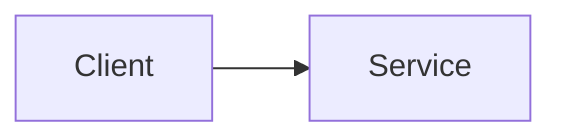

# NN. Название темы

Дата: YYYY-MM-DD

## Суть

## Как работает

## Trade-offs
| Вариант | Плюсы | Минусы | Когда выбирать |
|---|---|---|---|

## Схема

## Пример из реальных систем

## Задача (если решали)
